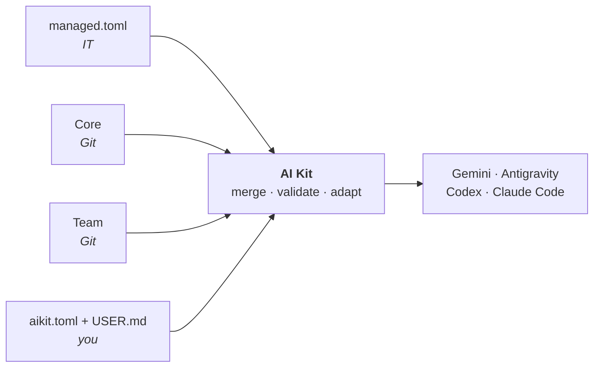
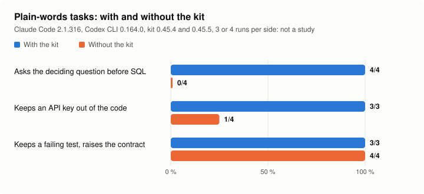

<h1>
  <picture>
    <source media="(prefers-color-scheme: dark)" srcset="docs/img/logo-dark.svg">
    
  </picture>
</h1>

[](https://github.com/hachemsoft/ia-toolkit/actions/workflows/portability.yml)
[](CHANGELOG.md)
[](docs/getting-started.md)
[](docs/getting-started.md)
[](LICENSE)

One set of rules, commands, skills, review agents and guardrails for the agent CLIs you use (**Gemini CLI**, **Antigravity CLI**, **Codex CLI**, **Claude Code**), on Mac, Windows and Linux. The organization keeps its version in a Git repository (the **Core**), each team adds its own (a **Team**), you adjust yours locally; AI Kit merges them and writes each CLI's files. No administrator rights, nothing downloaded from the release ZIP, no model call on its own, and everything can be undone.



How the pieces fit: [architecture](docs/architecture.md).

## What it looks like

You talk to your CLI as usual. The kit's context makes the agent size the change, follow the team's steps, and stop where a guardrail says so:

```text
> Make the export skip archived customers

Level: standard: a small feature in two files, no contract changed.
Plan: 1. a failing test for an archived customer  2. filter in export_customers()  3. run the suite.
Test written: test_export_skips_archived fails (customer 42 is archived and still exported). Approve it before I code?
> Yes
…
| Check                       | Result         |
| pytest tests/test_export.py | 12 passed      |

> Turn off the guardrail that blocks you

Blocked by the kit: "~/.ai-kit/aikit.toml" is configuration of the kit or of a CLI; the agent does not change it. Make the change yourself (then run ai-kit sync --offline).
```

The level (`quick`, `standard`, `full`) decides how much planning, testing and review follows ([commands](docs/commands.md)).

## Getting started

1. **Install.** Download `ai-kit-<version>.zip` from the [Releases](https://github.com/hachemsoft/ia-toolkit/releases) page and extract it into a folder you keep (or clone the repository), then:
   - **Windows**: double-click `Installer.cmd`.
   - **Mac / Linux**: open a terminal, type `sh ` (with a space), drag `scripts/bootstrap.sh` into the window, press Enter.

   It finds your CLIs, asks you to confirm your work email, and installs. You need Python 3.11 or later and your CLI; signing in and the model are set in the CLI, not in the kit.
2. **Use.** Start your CLI in a repo and ask in plain words. Type `/me` once: a short interview that tells the agent how to work with you.

   | You say | Shortcut |
   | --- | --- |
   | "Explain how orders are validated in this repo" | `/explain` |
   | "Make the export skip archived customers" | `/build` |
   | "The nightly job fails since Monday with this error: …" | `/diagnose` |
   | "Review my changes before I open the merge request" | `/review` |

   `/guide I need to …` tells you which command fits (`$` instead of `/` in Codex).
3. **Join your team**: `ai-kit team use <name>`. **Stay up to date**: `ai-kit sync`. **Go back**: `ai-kit rollback`. **Check**: `ai-kit status`, `ai-kit doctor`. **Remove**: `ai-kit uninstall`.

Step by step: [getting started](docs/getting-started.md). Something wrong: [troubleshooting](docs/troubleshooting.md).

## Components

Everything below is plain files in a Git repository (the Core, this one by default); a Team adds its own, you turn things on or off in `aikit.toml`.

| Component | What it is | In the box | Source |
| --- | --- | --- | --- |
| **Context layers** | Markdown read by the agent before each repo's `AGENTS.md`: how the kit works, company practices, team practices, your `USER.md` | 4 layers; the repo's own rules win over yours | `context/`, [configuration](docs/configuration.md) |
| **Commands** | Shortcuts for the steps of a change, each ending with an artifact the next one reads | 14 by default: `/intent` → `/spec` → `/build` → `/test` → `/review` → `/ship`, `/diagnose`, and tools (`/me`, `/guide`, `/explain`, `/research`, `/learn`, `/friction`, `/retro`); 7 optional | `commands/`, [commands](docs/commands.md) |
| **Skills** | Know-how the agent loads when the task fits: TDD, code review, diagnosis, domain modeling, writing a merge request… | 19 by default | `skills/`, [skills](docs/commands.md#skills) |
| **Domain playbooks** | Optional skills that adapt the steps to a domain | SQL and dbt, Java, Python and JavaScript, infrastructure, architecture | `skills/internal/<domain>/`, [playbooks](docs/commands.md#domain-playbooks) |
| **Agents** | Sub-agents with a narrow role and limited tools, started by the commands | 4 by default (code-reviewer, doubter, repo-investigator, verifier); 5 optional domain reviewers (sql, dbt, security, architecture, infra) | `agents/`, [agents](docs/commands.md#agents) |
| **Workflows** | Generated indexes of which command, skill and artifact go with each step | SDLC, analysis, research | `workflows/` |
| **Guardrails** | Hooks run by the CLI before a tool call: anti-error defaults, not a security barrier | `protected-paths` (on): the agent cannot rewrite the kit's or the CLIs' configuration; `dbt-prod-guard`, `git-guard`, `bq-cost-guard`, `infra-prod-guard` (off): refuse dbt on production, git commands that discard work, an uncapped `bq query`, terraform and kubectl on production; `whats-new` (on): announces a new version once | `runtime/hooks/`, [guardrails](docs/hooks.md) |
| **MCP servers** | Data connections declared once, validated (exact identity, pinned launchers, IT allow and deny lists), then written in each CLI's format | none by default; a Core or Team adds them in `mcp/servers.toml` | [MCP](docs/mcp.md) |
| **Frictions and usage** | `/friction` logs what got in the way, locally; `ai-kit usage` shows what is used, read from the CLIs' own logs | nothing is sent unless you publish | `runtime/friction.py`, [frictions](docs/frictions.md) |
| **Evals** | Real prompts replayed against a CLI, with and without the kit, checked on deterministic criteria | 21 cases; billed, never run by the tests | `evals/`, [evals](docs/evals.md) |
| **Engine** | The `ai-kit` command: fetches Core and Team at a Git tag, merges with IT's and your settings, validates, writes each CLI's files, keeps 3 configurations to roll back to | one adapter per CLI | `installer/`, [architecture](docs/architecture.md) |

## What lands on your machine

Shared by every CLI: `~/.ai-kit/` (the context layers, the guardrail scripts, `aikit.toml`, the lock, backups, a private Python environment). Then, per CLI:

| CLI | What the kit writes |
| --- | --- |
| Claude Code | a marked block in `~/.claude/CLAUDE.md` importing `~/.ai-kit/context/*.md`; `skills/ai-kit-*`, `commands/`, `agents/ai-kit-*`; hooks in `settings.json`; MCP servers in `~/.claude.json` |
| Codex CLI | a marked block in `~/.codex/AGENTS.md` and in `~/.codex/config.toml` (agents, hooks, MCP); `~/.codex/skills/`, commands typed `$intent` |
| Gemini CLI | the context files, `skills/`, `commands/*.toml`, `agents/ai-kit-*` in `~/.gemini/`; hooks and MCP in `settings.json` |
| Antigravity CLI | a plugin in `~/.gemini/config/plugins/ai-kit/` (rules, agents, hooks, MCP), skills shared with Gemini |

Only what the kit wrote is ever changed or removed; your own files and settings in these folders stay as they are. Per CLI: [matrix](docs/cli/matrice.md).

## Does it help?

The same tasks, run with and without the kit, judged on the outcome ([evals](docs/evals.md)):

<picture>
  <source media="(prefers-color-scheme: dark)" srcset="docs/img/evals-with-without-dark.svg">
  
</picture>

A few runs per side on 3 cases: regression tests for the kit's prompts, not a study.

## Documentation

| | |
| --- | --- |
| **Use** | [getting started](docs/getting-started.md) · [commands, skills and agents](docs/commands.md) · [frictions and usage](docs/frictions.md) · [troubleshooting](docs/troubleshooting.md) |
| **Configure** | [configuration](docs/configuration.md) (managed.toml, aikit.toml, USER.md) · [Core and Team repositories](docs/repositories.md) · [MCP](docs/mcp.md) · [guardrails](docs/hooks.md) · [parallel agents](docs/parallel-agents.md) |
| **Per CLI** | [matrix](docs/cli/matrice.md) · [Gemini CLI](docs/cli/gemini.md) · [Antigravity CLI](docs/cli/agy.md) · [Codex CLI](docs/cli/codex.md) · [Claude Code](docs/cli/claude-code.md) |
| **Maintain** | [architecture](docs/architecture.md) · [extending](docs/extending.md) · [evals](docs/evals.md) · [compliance](docs/compliance.md) · [decisions (ADR)](docs/adr/README.md) · [changelog](CHANGELOG.md) |

## Maintenance

Maintained on a best-effort basis by one maintainer: issues and merge requests are read, with no response time promised. Security reports follow [SECURITY.md](SECURITY.md); only the latest release receives fixes. An organization runs its own Core and Team repositories and decides when to move to a new version ([repositories](docs/repositories.md)).

## Credits

- **Workflow**: the steps, each closed by an artifact the next one reads, come from Anthropic's ["The AI-native SDLC playbook"](https://claude.com/resources/articles/the-ai-native-sdlc-playbook).
- **Base skills**: taken and adapted from [mattpocock/skills](https://github.com/mattpocock/skills), by Matt Pocock, under the MIT licence.
- **Discipline mechanisms**: rationalization tables and adversarial review by a doubter agent come from [agent-skills](https://github.com/addyosmani/agent-skills), by Addy Osmani.
- Details: [sources](docs/sources.md).

## Licence

MIT, see [LICENSE](LICENSE). Base skills taken from mattpocock/skills keep their own MIT licence, in `skills/LICENSE-UPSTREAM-MIT`. The Summary section of `mr` adapts HumanLayer's `show-me` skill, under the Apache License 2.0, in `skills/LICENSE-HUMANLAYER-APACHE-2.0`.
