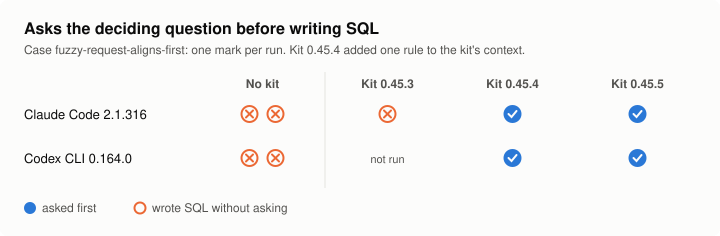

<h1>
  <picture>
    <source media="(prefers-color-scheme: dark)" srcset="docs/img/logo-dark.svg">
    
  </picture>
</h1>

A foundation for working with a coding agent as a team, on Mac and Windows. It configures the agent CLIs you choose (**Gemini CLI**, **Antigravity CLI**, **Codex CLI** and **Claude Code**) with the same content: layered context, a command-based workflow, domain playbooks, review agents and guardrails. It installs without administrator rights or download, and never calls the model on its own.

## Getting started

1. **Install**: clone the repository (your organization's copy if it has one) into a folder you keep, then:
   - **Windows**: double-click `Installer.cmd`.
   - **Mac**: open Terminal, type `sh ` (with a space), drag `scripts/bootstrap.sh` from the cloned folder into the window, press Enter.

   Without git, or without access to a Python package index: download `ai-kit-<version>.zip` from the [Releases](https://github.com/hachemsoft/ia-toolkit/releases) page, extract it and run the same launcher; it installs everything from the ZIP, with no download.

   A short guided screen asks which CLIs you use and the profile closest to your job (**General** if in doubt), shows what will change, then installs.
2. **Use**: open a terminal in your repo, start your CLI and ask in plain words. Type `/me` once: a short interview that tells the agent how to work with you.

   | You say | Shortcut |
   | --- | --- |
   | "Explain how orders are validated in this repo" | `/explain` |
   | "Make the export skip archived customers" | `/build` |
   | "The nightly job fails since Monday with this error: …" | `/diagnose` |
   | "Review my changes before I open the merge request" | `/review` |

   `/guide I need to …` tells you which command fits (`$` instead of `/` in Codex).
3. **When something goes wrong**: run the installer again and choose **Check the installation**, then [Troubleshooting](docs/troubleshooting.md).

You need Python 3.9 or later and your CLI, provided by your company; signing in and choosing the model are done in the CLI. Step by step: [getting started](docs/getting-started.md). For IT: [validation on enterprise workstations](docs/validation.md) and [compliance](docs/compliance.md).

**Update**: `ai-kit update` in a terminal (the installer adds the `ai-kit` command to your own PATH, unless you said no: then `Installer.cmd update`, Mac `sh scripts/bootstrap.sh update`, from the cloned folder) fetches the new version, reinstalls and reapplies; your choices and files are kept. Never `pip install` the kit next to it: that makes a second copy `update` does not touch. From a ZIP: extract the new ZIP and run its installer. **Uninstall**: run the installer and choose **Uninstall**; only what the kit installed goes.

## Profiles

| Profile | For | Adds to the base |
| --- | --- | --- |
| **General** | any development role | — (workflow, tools, code review) |
| **Java Developer** | Maven or Gradle, Spring, JUnit | `java-change` playbook, security review |
| **DevOps** | Terraform, Kubernetes, Helm, CI/CD | `infra-change` playbook, infrastructure and security reviews |
| **Architect** | architecture decisions, design | `architecture-decision` playbook (ADR), architecture review |
| **Data Analyst** | SQL, dbt, BigQuery, KPIs | SQL, dbt, BigQuery and KPI playbooks, SQL and dbt reviews |
| **Data Developer** | the same, plus Python and JavaScript | the same, plus `python-js-change` and code review |

A profile is a starting point: the installer adds or removes a playbook, a command or an agent without editing any file.

## What it is

- **Layered context**: company practices, team practices and your preferences, read before each repo's own `AGENTS.md`; the organization decides its layer in `organization.toml`.
- **A workflow**: one command per step (`/intent`, `/spec`, `/build`, `/test`, `/review`, `/ship`, `/diagnose`), with ceremony matched to the stakes; the agent states the level on its first line. See [workflow](docs/workflow.md).
- **Domain playbooks and review agents** that activate when the task calls for them; yours are added the same way ([extending](docs/extending.md)).
- **Guardrails** that refuse an agent's writes to the configuration of the kit and of the CLIs, and dbt commands on production ([guardrails](docs/hooks.md)).
- **A feedback loop**: `/friction`, a local usage review, and per-skill versions so an update says what changed.

## Does it help?

The same tasks, run with and without the kit, judged on the outcome ([evals](docs/evals.md#with-and-without-the-kit)):

<picture>
  <source media="(prefers-color-scheme: dark)" srcset="docs/img/evals-with-without-dark.svg">
  
</picture>

<picture>
  <source media="(prefers-color-scheme: dark)" srcset="docs/img/evals-framing-dark.svg">
  
</picture>

Two runs per task, side and CLI, on Claude Code 2.1.316 and Codex CLI 0.164.0: a clear signal, not a study. The results are in `evals/results/`; `scripts/eval_charts.py` redraws the charts.

## Supported CLIs

| CLI | Commands |
| --- | --- |
| Gemini CLI | `/guide` |
| Antigravity CLI (`agy`) | `/guide` |
| Codex CLI | `$guide` |
| Claude Code | `/guide` |

Where each file goes and what differs: [CLI matrix](docs/cli/matrice.md).

## Documentation

- **Use**: [getting started](docs/getting-started.md), [workflow](docs/workflow.md), [tools](docs/tools.md), [agents](docs/agents.md), [project layer](docs/project-context.md), [Troubleshooting](docs/troubleshooting.md).
- **Customize**: [customization](docs/customization.md), [extending](docs/extending.md), [guardrails](docs/hooks.md), [MCP](docs/mcp.md), [identity](docs/identity.md).
- **Per CLI**: [matrix](docs/cli/matrice.md), [Gemini CLI](docs/cli/gemini.md), [Antigravity CLI](docs/cli/agy.md), [Codex CLI](docs/cli/codex.md), [Claude Code](docs/cli/claude-code.md), [moving from Gemini to agy](docs/cli/gemini-to-agy.md).
- **Deploy and maintain**: [installer](docs/installer.md), [validation](docs/validation.md), [compliance](docs/compliance.md), [architecture](docs/architecture.md), [contributing](docs/contributing.md), [command format](docs/format.md), [skills reference](docs/skills-reference.md), [evals](docs/evals.md), [usage review](docs/usage-review.md), [pilot](docs/pilot.md), [sources](docs/sources.md), [changelog](CHANGELOG.md).

## Credits and inspiration

- **Workflow**: the steps, each closed by an artifact the next one reads, come from Anthropic's ["The AI-native SDLC playbook"](https://claude.com/resources/articles/the-ai-native-sdlc-playbook).
- **Base skills**: taken and adapted from [mattpocock/skills](https://github.com/mattpocock/skills), by Matt Pocock, under the MIT licence.
- **Discipline mechanisms**: rationalization tables and adversarial review by a doubter agent come from [agent-skills](https://github.com/addyosmani/agent-skills), by Addy Osmani.
- **Other sources**: [pstack](https://github.com/cursor/plugins/tree/main/pstack), and Switch Dimension's comparison of skill packs, the source of the "ceremony matches the stakes" rule. Details in [sources](docs/sources.md).

## Licence

MIT, see [LICENSE](LICENSE). Base skills taken from mattpocock/skills keep their own MIT licence, in `skills/LICENSE-UPSTREAM-MIT`.
