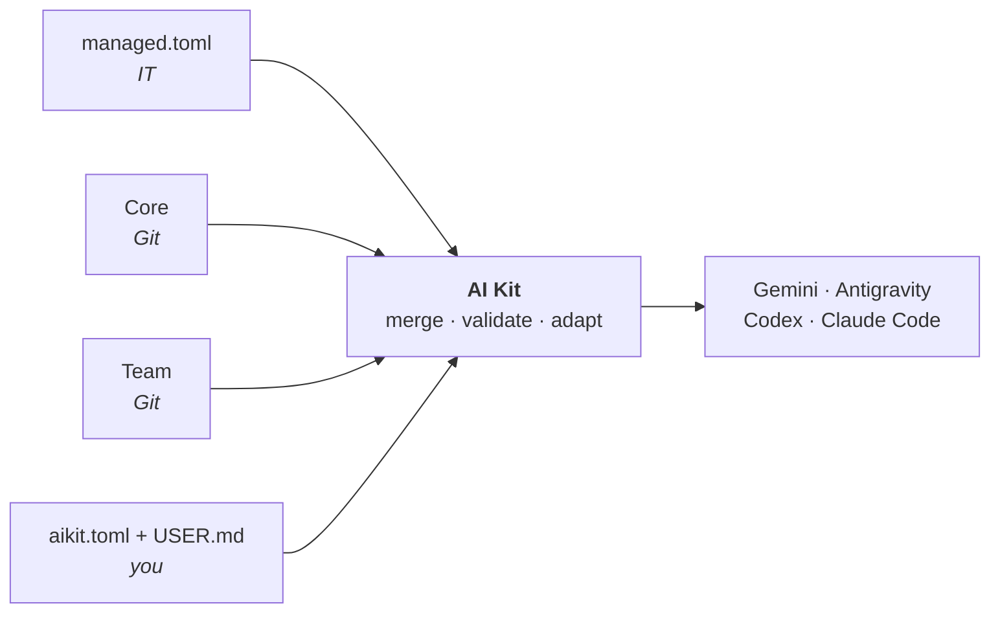

<h1>
  <picture>
    <source media="(prefers-color-scheme: dark)" srcset="docs/img/logo-dark.svg">
    
  </picture>
</h1>

One set of rules, commands, skills, review agents and guardrails for the agent CLIs you use (**Gemini CLI**, **Antigravity CLI**, **Codex CLI**, **Claude Code**), on Mac and Windows. The organization keeps its version in a Git repository (the **Core**), each team adds its own (a **Team**), you adjust yours locally; AI Kit merges them and writes each CLI's files. No administrator rights, nothing downloaded from the release ZIP, no model call on its own, and everything can be undone.

How the pieces fit: [architecture](docs/architecture.md).

## Getting started

1. **Install.** Download `ai-kit-<version>.zip` from the [Releases](https://github.com/hachemsoft/ia-toolkit/releases) page and extract it into a folder you keep (or clone the repository), then:
   - **Windows**: double-click `Installer.cmd`.
   - **Mac**: open Terminal, type `sh ` (with a space), drag `scripts/bootstrap.sh` into the window, press Enter.

   It finds your CLIs, asks you to confirm your work email, and installs. You need Python 3.11 or later and your CLI; signing in and the model are set in the CLI, not in the kit.
2. **Use.** Start your CLI in a repo and ask in plain words. Type `/me` once: a short interview that tells the agent how to work with you.

   | You say | Shortcut |
   | --- | --- |
   | "Explain how orders are validated in this repo" | `/explain` |
   | "Make the export skip archived customers" | `/build` |
   | "The nightly job fails since Monday with this error: …" | `/diagnose` |
   | "Review my changes before I open the merge request" | `/review` |

   `/guide I need to …` tells you which command fits (`$` instead of `/` in Codex).
3. **Join your team**: `ai-kit team use <name>`. **Stay up to date**: `ai-kit sync`. **Go back**: `ai-kit rollback`. **Check**: `ai-kit status`, `ai-kit doctor`. **Remove**: `ai-kit uninstall`.

Step by step: [getting started](docs/getting-started.md). Something wrong: [troubleshooting](docs/troubleshooting.md).

## What you get

| | For | What |
| --- | --- | --- |
| **Core default** | everyone | the context layers, the workflow commands (`/intent` → `/spec` → `/build` → `/test` → `/review` → `/ship`, `/diagnose`), tools, code review and the general agents, guardrails |
| **Core optional** | turned on by a Team or by you | domain playbooks (SQL and dbt, Java, infrastructure, architecture, Python and JavaScript), their review agents, more commands |
| **Team** | one team's members | its own repository: its practices, skills, agents, MCP servers, and the optional resources it turns on |

- **Layered context**: company practices, team practices and your `USER.md`, read before each repo's `AGENTS.md`.
- **Ceremony matched to the stakes**: the agent states the level of a change on its first line and plans, tests and reviews accordingly ([commands](docs/commands.md)).
- **Guardrails against mistakes**, not a security barrier: the agent cannot rewrite the kit's or the CLIs' configuration, dbt on production can be refused ([guardrails](docs/hooks.md)).
- **A feedback loop**: `/friction` logs what got in the way, `ai-kit usage` shows what is used ([frictions](docs/frictions.md)).

## Does it help?

The same tasks, run with and without the kit, judged on the outcome ([evals](docs/evals.md)):

<picture>
  <source media="(prefers-color-scheme: dark)" srcset="docs/img/evals-with-without-dark.svg">
  
</picture>

A few runs per side on 3 cases: regression tests for the kit's prompts, not a study.

## Documentation

| | |
| --- | --- |
| **Use** | [getting started](docs/getting-started.md) · [commands, skills and agents](docs/commands.md) · [frictions and usage](docs/frictions.md) · [troubleshooting](docs/troubleshooting.md) |
| **Configure** | [configuration](docs/configuration.md) (managed.toml, aikit.toml, USER.md) · [Core and Team repositories](docs/repositories.md) · [MCP](docs/mcp.md) · [guardrails](docs/hooks.md) |
| **Per CLI** | [matrix](docs/cli/matrice.md) · [Gemini CLI](docs/cli/gemini.md) · [Antigravity CLI](docs/cli/agy.md) · [Codex CLI](docs/cli/codex.md) · [Claude Code](docs/cli/claude-code.md) |
| **Maintain** | [architecture](docs/architecture.md) · [extending](docs/extending.md) · [evals](docs/evals.md) · [compliance](docs/compliance.md) · [decisions (ADR)](docs/adr/README.md) · [changelog](CHANGELOG.md) |

## Credits

- **Workflow**: the steps, each closed by an artifact the next one reads, come from Anthropic's ["The AI-native SDLC playbook"](https://claude.com/resources/articles/the-ai-native-sdlc-playbook).
- **Base skills**: taken and adapted from [mattpocock/skills](https://github.com/mattpocock/skills), by Matt Pocock, under the MIT licence.
- **Discipline mechanisms**: rationalization tables and adversarial review by a doubter agent come from [agent-skills](https://github.com/addyosmani/agent-skills), by Addy Osmani.
- Details: [sources](docs/sources.md).

## Licence

MIT, see [LICENSE](LICENSE). Base skills taken from mattpocock/skills keep their own MIT licence, in `skills/LICENSE-UPSTREAM-MIT`.
