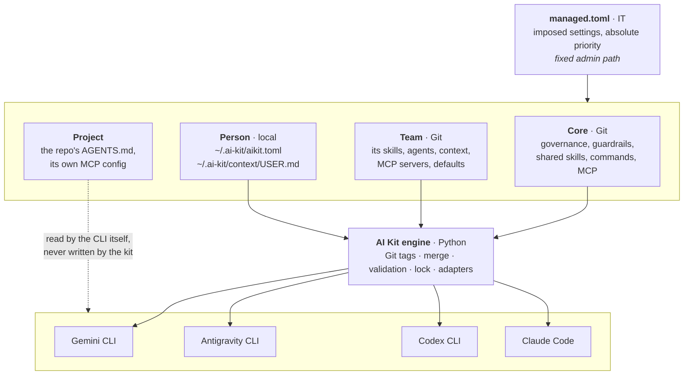
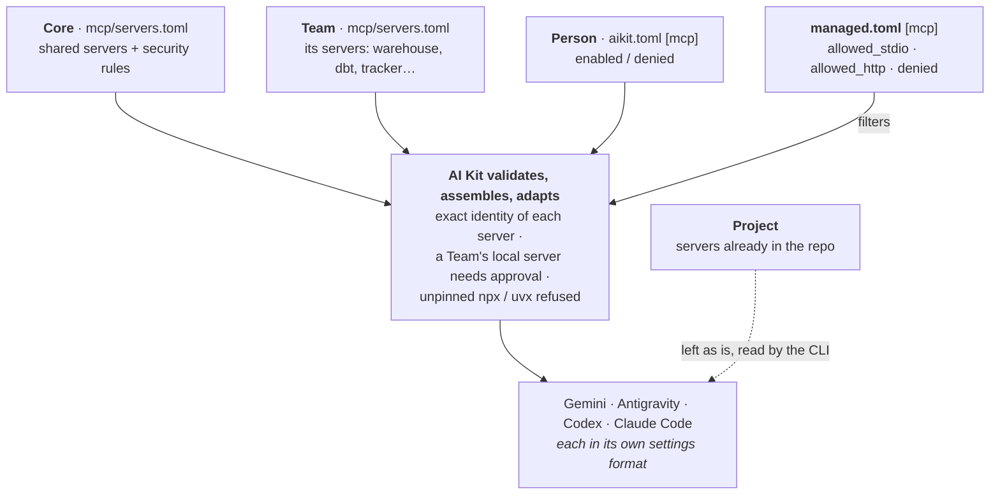
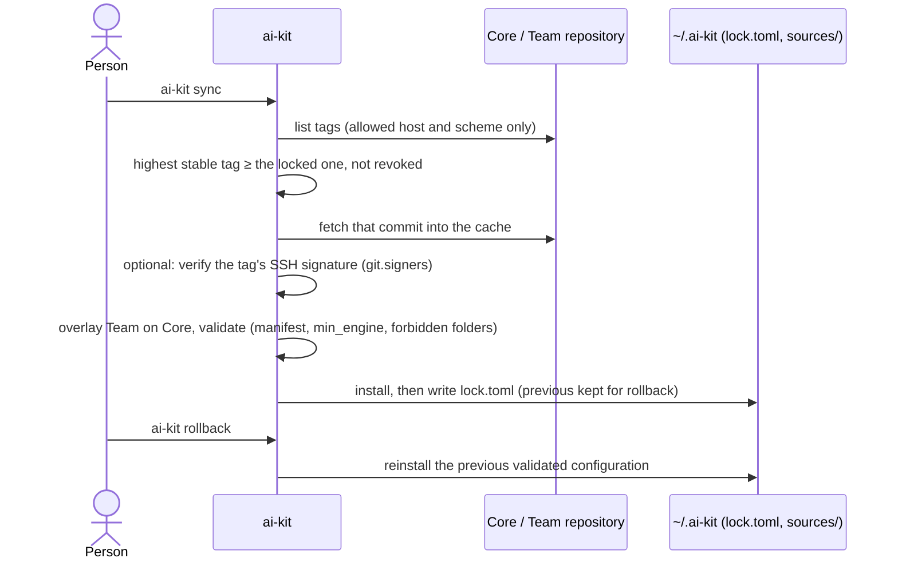
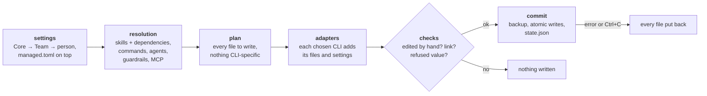

# Architecture

How AI Kit turns a few Git repositories and settings files into the configuration of four agent CLIs. Read this first; the code entry points are `installer/cli.py` (the command line) and `installer/interface.py` (the contracts).

## The layers

Five sources, one engine, four CLIs. Each source owns one kind of decision; the engine validates and merges them, then writes each CLI's files in its own format.

| Source | Who writes it | What it decides | Where |
| --- | --- | --- | --- |
| `managed.toml` | IT | the Core repository, allowed Git hosts, locked guardrails, MCP allow and deny lists, the friction tracker | a fixed admin path ([configuration](configuration.md)) |
| Core | the organization | the kit context, company practices, the commands, the skills and agents (default and optional), guardrails, approved MCP servers | a Git repository, used at its highest stable tag: this repository by default |
| Team | one team | its practices (`20_TEAM.md` replaced), its own skills and agents, optional Core resources turned on, its MCP servers | a Git repository with `kind = "team"` ([repositories](repositories.md)) |
| Person | you | extra or disabled resources, guardrails, MCP servers on or off, frictions, your `USER.md` | `~/.ai-kit/aikit.toml`, `~/.ai-kit/context/USER.md` |
| Project | the repo's maintainers | its rules and glossary, its own MCP servers | the repo (`AGENTS.md`, `GLOSSARY.md`, the CLI's project files): the kit never writes there |

**Precedence.** A value: `managed.toml` > person > Team > Core. A restriction (a denied server, a locked guardrail, a refused host): every layer's applies, and none can lift IT's ([ADR 0015](adr/0015-managed-wins-values-resolve-restrictions-all-apply.md)). Lists add up; a person removes an item with `disabled_*`.

**Context read by the agent**, in order: `00_KIT.md` (how the kit works), `10_COMPANY.md`, `20_TEAM.md` (or the Team's own), `USER.md`, then the repo's `AGENTS.md`. The repo wins over `USER.md`; nothing lifts a practice or a guardrail.

## MCP servers

A server's identity is a digest of what it runs (command, arguments, environment, folder) or where it connects (URL, headers). IT allows identities, not names; a local server a Team brings runs only once IT lists its identity or you approve it once in a terminal, recorded in `~/.ai-kit/state.json`. Details: [MCP](mcp.md), [ADR 0022](adr/0022-mcp-exact-identities-approved-upstream-or-locally.md).

## Sources: tags, lock, rollback

The Core and the Team are Git repositories used only at signed-off versions: annotated tags `vX.Y.Z`, never a branch.

- **Offline first install**: the release ZIP ships the Core as `core/ai-kit-core.bundle`; `init` activates it without network. `sync --offline` re-applies the locked versions after you edit `aikit.toml`.
- **Git without surprises**: the kit runs `git` with hooks, credential helpers and local config neutralised, extracts without `tar`, and refuses an origin outside `git.allowed_hosts` ([ADR 0016](adr/0016-git-sources-anchored-origin-tar-free-extraction.md)).
- **A Team never replaces governance**: a Team repository may not ship `commands/`, `policies/`, `hooks/` or `runtime/`.
- **Rollback** returns to the previous validated Core and Team; a second rollback comes back ([ADR 0017](adr/0017-rollback-to-one-of-three-validated-configurations.md)).

## One installation, step by step

| Step | Code |
| --- | --- |
| Launcher: find Python 3.11+, private venv `~/.ai-kit/runtime`, install the engine from the ZIP's wheels | `Installer.cmd`, `scripts/bootstrap.sh`, `scripts/launcher.py` |
| Command line, sources | `installer/cli.py`, `installer/sync.py`, `installer/sources.py`, `installer/bootstrap.py` |
| Settings and IT rules | `installer/settings.py`, `installer/config.py`, `installer/managed.py` |
| Resolution and plan | `installer/resolve.py`, `installer/plan.py`, `installer/interface.py` |
| One module per CLI | `installer/adapters/` (`gemini`, `agy`, `codex`, `claude`) |
| All-or-nothing writes, uninstall | `installer/commit.py`, `installer/lifecycle.py` |
| Read-only reports | `installer/status.py`, `installer/doctor.py`, `installer/usage.py`, `installer/validate.py` |
| What runs inside the CLIs | `runtime/hooks/` (guardrails, session start), `runtime/friction.py` |

**The adapter contract.** A CLI is one module in `installer/adapters/`, listed in `ADAPTERS`, following the `Adapter` protocol: `install(plan)` adds its files, `finalize(plan, active)` merges its settings (and removes the kit's entries when the CLI is dropped), `doctor(ctx)`, `history(home, state)` for `ai-kit usage`. `cli.py` names no CLI. Where each file lands: [CLI matrix](cli/matrice.md).

## Repository layout

| Folder | Content | Shipped as |
| --- | --- | --- |
| `installer/`, `runtime/`, `schemas/`, `templates/` | the engine | the Python package (wheel) |
| `aikit.toml`, `context/`, `commands/`, `skills/`, `agents/`, `workflows/`, `templates/`, `mcp/`, `CHANGELOG.md`, `NEWS.md` | the Core content | Git tags of this repository; `core/ai-kit-core.bundle` in the ZIP |
| `examples/team-repo/` | a Team repository to copy | — |
| `tests/`, `evals/`, `scripts/` | offline tests, paid model evals, build and check scripts | the source only |

## Invariants

A test guards each.

- **No byte changes by accident**: `tests/golden/install-snapshot.json` holds the digest of every file of 16 scenarios; `python3 tests/snapshot.py --update` after an intended change.
- **A file you edited is never overwritten**: managed files are tracked by digest; an edit stops the run (a rule layer is put back, your copy kept in `~/.ai-kit/backups/`).
- **All or nothing**: atomic writes; an error or Ctrl+C restores every file.
- **No model call** in `init`, `sync`, `status`, `doctor`, `uninstall` or the tests (`scripts/offline_tests.py` takes the CLIs off the PATH); only `doctor --live --yes` calls one. **No network** except `init`, `sync` and `team` towards allowed Git hosts, and `doctor --live`, which fetches the tags of a cloned kit folder.
- **No administrator rights**: everything under the home folder; the only change outside the kit's files is your own PATH, when you choose the `ai-kit` command.
- **Every skill and agent has a version**, raised at each change (`versions.lock.json`).
- **Small and readable**: no `installer/` module over 800 lines; the kit context under 3,800 characters and each command under 4,000, because they load at every session.

## What the kit does not control

| Dependency | What breaks it | How it shows |
| --- | --- | --- |
| Each CLI's file layout and settings format | a CLI release that moves a folder or renames a key | `doctor`; the weekly `cli-drift` workflow reads each CLI's `--help` |
| The CLIs' logs read by `ai-kit usage` | an undocumented format change | `usage` says it recognised nothing |
| `~/.claude.json`, rewritten by Claude Code while it runs | a `sync` during an open session | close Claude Code first |
| Whether the model follows a skill or a rule | the model | evals ([evals](evals.md)); guardrails for what must not happen |

Decisions and their reasons: [ADRs](adr/README.md).
