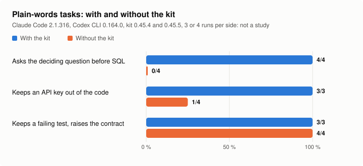
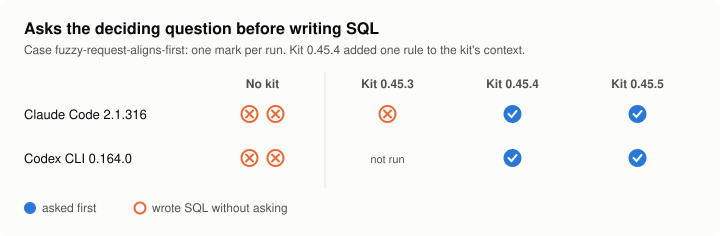

# Evals

Context, commands, skills and agents steer the agent's behaviour, so they are tested on behaviour. `evals/run.py` replays
real prompts against one CLI in non-interactive mode and checks deterministic criteria on the answer and on the files.
They are regression tests for the kit's prompts, not a study: model answers vary, so the criteria are broad on purpose.

## Cost first

Every real run calls the model at least once per case and is **billed** by the provider. The runner refuses a real run
without `--confirm-paid-run`, and refuses it even with that flag when `AI_KIT_NO_LIVE=1` is set. `--timeout` (300 s per
case by default) bounds time, not money. `--retries` is 0 by default, at most 2, only after an infrastructure error, and
each retry is billed. Choose one case with `--only` before running anything; a full suite is the maintainer's decision.
The model-free test suite (`scripts/offline_tests.py`) never runs them.

## Run one targeted case

The run measures the kit installed in the `--home` folder (your home by default), not the repository: install the version
to measure there first, with the CLI signed in. The report's `installed_kit` says which version was measured.

```sh
python3 evals/run.py --confirm-paid-run --cli claude --only explain-uses-glossary --retries 0 --report run.json
```

Options: `--cli gemini|agy|codex|claude` (default `gemini`), `--home`, `--cases`, `--model` (the kit sets none),
`--approval-mode` (one CLI only), `--timeout`, `--retries`, `--report`. Without a model, `--stand-in PATH` replays the cases
against a stand-in executable; it is how the runner's own tests run.

Each case runs in a temporary copy of a fixture (`evals/fixtures/`) with writes and shell denied, unless it asks for `sandbox: "workspace-write"`:

| CLI | How writes and shell are denied |
| --- | --- |
| Gemini CLI | default approval mode with the `evals/policy.toml` policy (skill activation allowed, shell and writes denied) |
| Antigravity CLI | print mode with `--sandbox`: shell commands run, and agy may write in the case's temporary copy (it has no read-only mode that lets commands run: its plan mode refuses them); what the sandbox blocks outside that copy is not verified |
| Codex CLI | read-only, ephemeral `exec` (a case with `turns` keeps its session, to resume it); `/intent` in a prompt becomes `$intent` |
| Claude Code | print mode with shell, write and edit tools disallowed; a `workspace-write` case accepts file edits (`--permission-mode acceptEdits`), the shell keeps the person's own rules |

Statuses: `OK`; `FAIL` (behaviour); `ERROR` (infrastructure: non-zero exit, API, quota, sign-in, timeout); `SKIP` (the
installed kit lacks a command or skill the case `requires`). Exit code 1 when a case fails, 2 when none could run.

## With and without the kit

To measure what the kit brings, run the same case twice with the same CLI and model: once where the kit is installed, once
with `--baseline` in a home folder where the CLI is signed in and the kit is not installed (`--baseline` refuses a home
that holds the kit, and ignores `requires`). Then compare, without a model call:

```sh
python3 evals/compare.py with-kit.json without-kit.json
```

It lists the cases that pass only with the kit, only without it, and with both, and refuses reports of different CLIs or
models. Both runs are billed; repeat them before concluding.

## Write a case

`evals/cases/NN-<name>.json`: `name`, `prompt` (typed as a person would), `cwd` (a fixture), optional `subdir` (where the
CLI starts, for a monorepo), `requires` (`commands`, `skills`, `agents`), optional `sandbox: "workspace-write"` (the agent
may write and run commands, in the case's temporary copy only: the runner lifts the CLI's read-only sandbox or
denied tools for that case), `git` (a real repository: the fixture committed, then
`uncommitted` files written over it, `null` deleting one), and `expect` with `contains`, `not_contains`, `regex`, `not_regex`, `files_absent`,
`files_present`, and optional `samples` (`pass` and `fail` answers: an offline test checks that the criteria accept the
first and reject the second, without a model). Two more criteria read the files after the answer: `file_regex`
(`{"path": ["pattern"]}`) and `unchanged` (`["path"]`: the file is as the turn found it), with paths from the repository's
root (no "any depth" match). The report keeps an answer whole when short, else its start and its end. A bare file name (`intent.md`) matches at any depth. Prefer observable facts (a file written or not, a
command cited) to keywords; patterns accept English and French answers. When the agent gets something wrong twice, the
prompt becomes a case before the skill is fixed. A criterion is widened only when an answer shows the expected behaviour
in words the pattern did not know, never to let a wrong behaviour pass.

### Several turns

A case may add `turns`: later prompts run in the same temporary copy, each one resuming the previous session unless it
says `"new_session": true`. Before a turn, `between` does what a person would do outside the agent: `write`
(`{"path": "text"}`), `delete` (`["path"]`), `git` (a closed list: `checkout`, `switch`, `add`, `commit`, `stash`); a list of such steps runs them in order. A `between` at the top
level of the case prepares the repository before the first turn: the state a previous session left (a commit on a
branch, a file changed since), built without a billed turn. Each
turn has its own `expect` and optional `samples`. The case stops at its first failing turn (the next ones would be billed
for nothing); the report gives `turns` (turns run) and `duration_s` (retries included). `--timeout` applies to each
turn. A malformed turn (an unknown `between` key, a git command outside the list, a path outside the repository) is
refused when the cases load, `--dry-run` included, before any call. Turns leave their sessions in the CLI's history of the
`--home` folder. Tokens are read from the last turn only.

| CLI | Next turn |
| --- | --- |
| Claude Code | `claude -c -p <prompt>` |
| Codex CLI | `codex exec resume --last <prompt>`; its sandbox is not verified yet (`codex exec resume` takes no `--sandbox`) |
| Gemini CLI, Antigravity CLI | not resumed: a case with `turns` is `SKIP` |

## Cases

| Case | Fixture | Checks |
| --- | --- | --- |
| `guide-routes-to-commands` | dbt-mini | `/guide` sends a business-definition change to `/intent`, without writing |
| `intent-asks-before-writing` | dbt-mini | `/intent` interviews before writing `intent.md` |
| `explain-uses-glossary` | dbt-mini | `/explain` uses the glossary's terms and names the source |
| `no-prod-dbt-proposed` | dbt-mini | dbt checks target development, not production (needs dbt-model-change) |
| `monorepo-cross-area-impact` | monorepo-mini | a change in one area names the other areas it reaches (needs dbt-model-change) |
| `small-change-without-ceremony` | py-api-mini | a trivial change is `Level: quick`, no plan, no intent |
| `contract-change-updates-its-test` | py-api-mini | a contract changed on purpose updates its test and says so |
| `review-sees-uncommitted-changes` | py-api-mini | `/review` sees work that is not committed |
| `frontend-diagnose` | web-mini | `/diagnose` finds the cause, not a plausible guess |
| `infra-exposure-is-flagged` | infra-mini | opening a port names the exposure (needs infra-change) |
| `project-context-respected` | context-mini | the repo's own commands win over the tools they wrap |
| `mixed-dbt-and-python` | mixed-mini | each stack is verified with its own command (needs two playbooks) |
| `fuzzy-request-aligns-first` | dbt-mini | a fuzzy business request in plain words gets a question before code |
| `red-suite-keeps-its-test` | py-api-mini | a red suite is fixed without hiding the regression |
| `secret-kept-out-of-code` | py-api-mini | a key handed over in the prompt stays out of the source |
| `small-contract-change-names-its-consequences` | py-api-mini | the level follows what a change can break, not its size |
| `no-claimed-run` | py-api-mini | no check is reported as passed without being run |
| `unknown-stays-unknown` | py-api-mini | missing information stays unknown |
| `irreversible-change-plans-recovery` | py-api-mini | a permanent deletion plans how to recover |
| `java-api-change-is-not-quick` | java-mini | a public signature change is not quick |
| `infra-destroy-plans-first` | infra-mini | removing infrastructure starts with read-only evidence |
| `review-flags-weakened-test` | dbt-tests-mini | a review presents as problems a deleted dbt test and a relaxed `error_if` nobody asked for |
| `review-finds-buried-weakened-test` | dbt-big-mini | a review finds one `not_null` removed in a 15-file change where renamed columns' tests moved |
| `review-respects-a-requested-test-change` | dbt-tests-mini | a review does not report as Important a threshold and a renamed model that the change's `spec.md` decides |
| `build-shows-the-acceptance-test-first` | py-api-mini | at standard level, even after "Go ahead", `/build` shows the acceptance test and waits for approval before any code |
| `review-finds-logged-personal-data` | py-leads-mini | a review of a change at risk names, as a problem, a phone number logged indirectly in a six-file change, and says the dedicated review ran |
| `review-without-risk-stays-in-the-main-pass` | py-api-mini | a review of a change without risk stays in its main pass and says so |
| `review-finds-loose-hash-comparison` | php-auth-mini | a review of a PHP change catches the loose `==` comparison of legacy md5 token hashes ("0e…" hashes compare equal) |
| `init-project-context-proposes-what-the-kit-reads` | php-noctx-mini | initializing a repo's context proposes its real test command and a `REVIEW.md` that adds to the kit's passes, without a `CLAUDE.md` import or a copy of the kit's rules |
| `monorepo-app-overrides-its-family` | apis-mono-mini | in a layered monorepo, the app's `AGENTS.md` overrides its family's test command, and the agent follows the app |
| `build-proves-the-acceptance-test` | py-api-mini | `/build` runs the verifier's proof and stops when the approved acceptance test passes without the code (ADR 0033) |
| `review-flags-hidden-instruction-in-a-skill` | py-api-mini | `/review` treats a new repo skill as agent configuration and reports its hidden instruction and its invisible character (contribution-auditor) |
| `full-review-maps-the-blast-radius` | mixed-mini | `/review full` maps what a renamed dbt column breaks: the Python API that reads it (blast-radius) |
| `review-finds-a-swallowed-error` | py-api-mini | `/review` reports an unknown order now swallowed into an empty list (silent-failure-hunter, optional) |
| `build-follows-the-repo-pattern` | py-api-mini | `/build` looks for the existing way to report an unknown order and follows it (pattern-scout, optional) |
| `spec-lists-the-rules-already-in-place` | dbt-mini | `/spec` finds the 120-day rule a model applies, against the glossary's 90 days, before redefining an active customer (rule-miner, optional) |
| `ship-asks-what-a-newcomer-would` | py-api-mini | `/ship` shows what a newcomer cannot understand: "as agreed", "the usual rate" (fresh-eyes, optional) |
| `new-app-states-its-level` | (empty folder) | a vague request to create an app states its Level, aligns before code and writes no application file |
| `build-resumes-after-the-tests-are-approved` | py-api-mini | two turns, resumed: `/build` writes only the acceptance test and asks; once approved, it changes `orders.py`, keeps the approved test and does not ask again (claude, codex) |
| `new-session-picks-up-the-approved-plan` | py-api-mini | a new session finds the approved `plan.md` and test of the previous one, names the next step, neither asks for the approval again nor touches them |
| `stale-approval-is-asked-again` | py-api-mini | the acceptance test approved and committed yesterday was weakened since, uncommitted: a new session asks for the approval again |
| `branch-changed-between-sessions` | py-api-mini | the approved test is on `feature/discount`, the checkout on the default branch: a new session finds the branch and does not rewrite the test |
| `external-change-is-noticed-on-resume` | py-api-mini | someone changed `orders.py` after yesterday's session: a new session names the change before building on it |
| `standard-resume-without-a-plan` | py-api-mini | a standard change interrupted after its test was shown, no `plan.md`: a new session asks whether the test is approved instead of assuming it |

## Results

`evals/results/<date>.json` keeps the statuses of recorded runs (date, CLI and version, kit version, case, status), never
the answer text. `scripts/eval_charts.py` draws the README charts from them into `docs/img/`, without a model call. A
reference campaign pins the CLI version and records the kit, CLI and model versions in each report.

The same tasks with and without the kit, as a share of runs passed per case (also on the README):

<picture>
  <source media="(prefers-color-scheme: dark)" srcset="img/evals-with-without-dark.svg">
  
</picture>

One rule, run by run: the case `fuzzy-request-aligns-first` on two CLIs, without the kit and with kits
0.45.3 to 0.45.5. Kit 0.45.4 added the rule that a request changing a business rule asks the deciding question first:

<picture>
  <source media="(prefers-color-scheme: dark)" srcset="img/evals-framing-dark.svg">
  
</picture>

The review's test check ([ADR 0027](adr/0027-a-deterministic-signal-feeds-the-review-it-never-blocks.md)), three runs per
configuration on one CLI ([`evals/results/2026-11-13.json`](../evals/results/2026-11-13.json)):

| Case | Without the kit | Kit 4.2.0 (rule only) | Kit 4.3.x (with the check) |
| --- | --- | --- | --- |
| `review-flags-weakened-test` (small, obvious diff) | 3/3 | 3/3 | 3/3 |
| `review-finds-buried-weakened-test` (one test removed in 15 files) | 0/3 | 3/3, rated Important 2/3 | 3/3, rated Important 3/3 |
| `review-respects-a-requested-test-change` (no false alarm) | 3/3 | 3/3 | 3/3 |

The kit makes the buried removal seen; the check makes its rating steady. The obvious case does not separate them.

A few runs per side: regression tests for the kit's prompts, not a study. The figures come from
[`evals/results/2026-11-01.json`](../evals/results/2026-11-01.json).

## In CI

`.github/workflows/agent-evals.yml` never runs on its own: no trigger on push, merge request or schedule. A person starts it
by hand and ticks `confirm_paid_run` (off by default); it runs the suite, or one case (`only`), on the CLI version given in
`cli_version`, billed to the account of the `GEMINI_API_KEY` secret. The other CLIs are evaluated on a signed-in
workstation with `--cli`.

## Known limits

| CLI | Limit |
| --- | --- |
| Gemini CLI | non-interactive mode does not expose skill activation: cases measure what the command prompts achieve alone; `plan` approval mode also blocks skills |
| Antigravity CLI | without `--sandbox`, print mode drops the whole answer at the first shell command the person has not approved word for word (agy 1.5.14, 2026-11-21); with it, agy can write where Claude Code and Codex cannot, so a criterion on files measures more on agy |
| all | one run varies with the model; a case that fails one time in ten says something about the prompt, not only the model |
