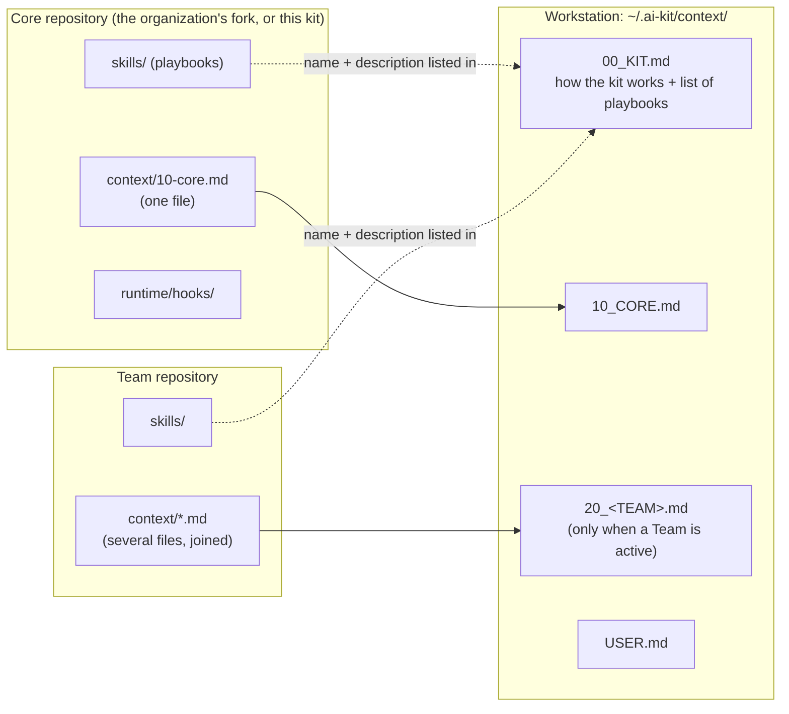
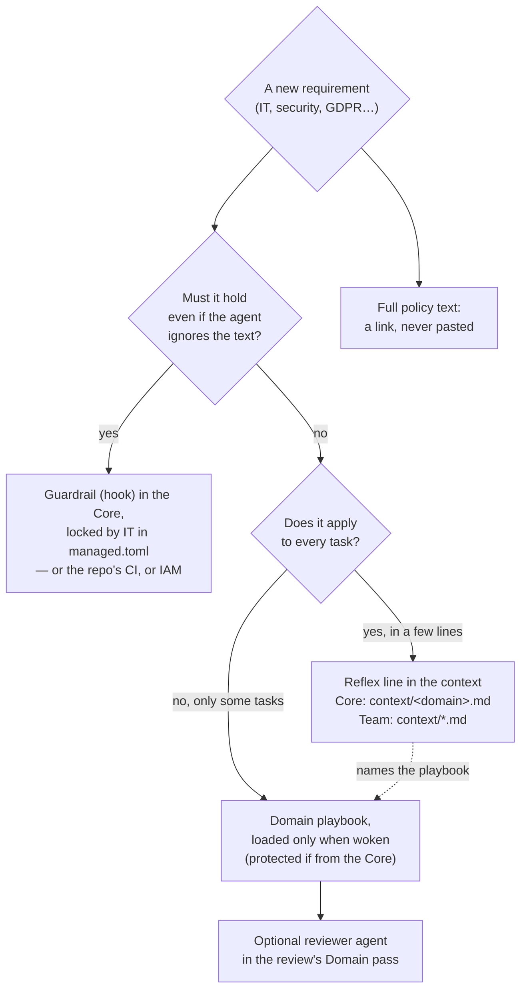
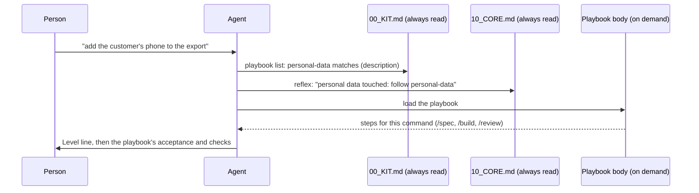
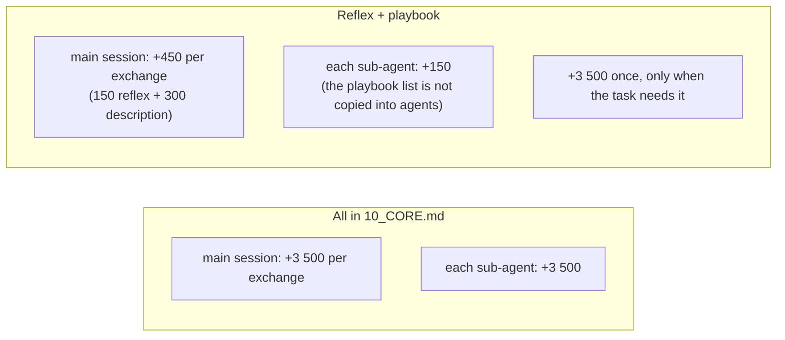
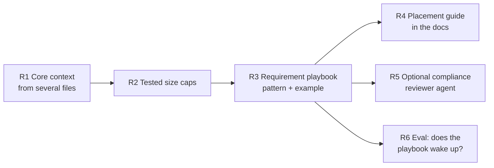

# Roadmap: organization requirements in the agent's context

Status: **ideas**, not started. Each item below is written to become one issue. Starting point: AI Kit 4.16.0
([ADR 0034](adr/0034-one-core-layer-a-team-layer-that-adds.md)).

## What we want to reach

An organization can give the agent its IT, security and personal-data (GDPR) requirements, each owned by the people
accountable for it, **without making every exchange heavier** and **without a Team being able to weaken them**.

Three outcomes:

1. **The right place for each requirement.** A rule that must hold is enforced, not written; a reflex is a line in the
   context; a procedure is loaded only when the task needs it; the full policy is a link.
2. **A context that stays light, by construction.** Every layer read at each exchange has a tested size cap, so a long
   policy cannot slip into it.
3. **Clear ownership.** Each requirement lives in its own file, reviewed by its owner (IT, security officer, data
   protection officer) through the repository's `CODEOWNERS`.

## Where we are (4.16.0)

What already works:

- A Team's context **adds** to the Core's, never replaces it; both reach every sub-agent's prompt.
- A Team cannot ship `hooks/` or `policies/`, and cannot replace a Core skill marked `aikit-protected: "true"`.
- Domain playbooks (`aikit-category: "domain"`) are listed by their description in `00_KIT.md`, and `/spec`, `/build`
  and `/review` follow the one that matches the files or the task, through its `## In the kit commands` section.

What is missing:

| Gap | Observed |
| --- | --- |
| The Core accepts **one** context file only | `installer/settings.py`: the selection is `['core']`, one `context/NN-core.md` |
| No size cap on the rule layers | only the `00_KIT` **template** is capped (4 300 characters, `tests/test_context_layers.py`) |
| The **rendered** `00_KIT.md` is not capped | 6 312 characters on one workstation: the generated list of commands and playbooks is not counted |
| No cap on a playbook's description | the ten kit playbooks range from 232 to 341 characters; each is read at every exchange |
| No written guide on where a requirement goes | nothing in `docs/extending.md` |

## The target model

Every requirement is sorted by **what it must guarantee**, not by who wrote it:

| Kind of requirement | Organization (Core, IT) | Team |
| --- | --- | --- |
| Must hold | Core hook, locked by IT (`hooks.locked`); MCP allow and deny lists; Git origins | not allowed: asks the Core |
| Reflex at every task (a few lines) | `context/<domain>.md`, joined into `10_CORE.md` | `context/*.md`, joined into `20_<TEAM>.md` |
| Procedure for some tasks | protected, default Core playbook | its own playbook, or an optional Core one it turns on |
| Review check | Core reviewer agent, may be protected | its own agent |
| Full policy | a link in the context file | a link in the context file |

### How a playbook wakes up

Three triggers, from the weakest to the strongest: the playbook's description in `00_KIT.md`; the step of a command
(`/build`, `/review`, `/spec`) that checks the installed playbooks; a reflex line in the Core context that names the
playbook. None is a guarantee: what must never be missed goes to a hook or to CI.

### Why it is lighter

Measured on this repository (characters; tokens are roughly a quarter of that for English text, an estimate):

| Element | Size | Read |
| --- | --- | --- |
| a real playbook body (`infra-change`, `kpi-definition`) | 3 380 and 3 688 | only when woken |
| a playbook description | 232 to 341 | at every exchange, in `00_KIT.md` |
| a two-line reflex in `10_CORE.md` | about 150 | at every exchange and in every sub-agent |

For a requirement the size of a playbook (about 3 500 characters):

About **8 times lighter** in the main session and **20 times** in sub-agents. Prompt caching lowers the cost of repeated
tokens, not the crowding: a shorter context is also followed better.

## Items (one issue each)

### R1. The Core's context from several files

- **Problem**: the IT, security and data protection owners all edit one `context/10-core.md`; ownership cannot be
  assigned per requirement, and a fork has to merge their texts by hand.
- **Goal**: every `context/*.md` of the Core is joined, in name order, into one `10_CORE.md`, as a Team's files already
  are into `20_<TEAM>.md`. Example: `00-practices.md`, `gdpr.md`, `it.md`, `security.md`, each owned in `CODEOWNERS`.
- **Unchanged**: the agent still reads 3 or 4 files; the CLI adapters, the protected-paths guardrail and rule 1 of
  `00_KIT` stay as they are.
- **Acceptance**: two Core context files give one `10_CORE.md` holding both in name order; a Core without any context
  file is refused by `ai-kit validate`; a Team named like a Core layer is still refused.
- **Open question**: a heading per joined file (`## gdpr`) so the agent and the reader see where a rule comes from?
- **Level**: full (the Core repository's contract changes).

### R2. Tested size caps on everything read at every exchange

- **Problem**: nothing stops a long policy from being pasted into a rule layer, and the rendered `00_KIT.md` is already
  well above the cap its template is tested against.
- **Goal**: one budget per layer, checked by `ai-kit validate` on a Core or Team repository and by the test suite:
  - `10_CORE.md` and `20_<TEAM>.md`: a cap each (2 000 characters proposed);
  - each playbook description: a cap (350 characters proposed, the current maximum is 341);
  - the **rendered** `00_KIT.md` with its lists: a cap, not only the template.
- **Acceptance**: a Core whose joined context exceeds the cap is refused, and the message names the largest file; a
  playbook with a too long description is refused with its name; the golden install stays under every cap.
- **Open questions**: the exact numbers; a warning band before the refusal?
- **Level**: standard (a new check; nothing installed changes while under the caps).

### R3. The requirement playbook pattern, with an example

- **Problem**: the mechanism exists (domain playbooks, protection, "In the kit commands") but nothing shows an
  organization how to use it for a requirement.
- **Goal**: an example `personal-data` playbook in `examples/` (not installed by the public Core): a description with
  precise triggers and a "Not for", `aikit-default: "true"` and `aikit-protected: "true"`, a body with the procedure, and
  `## In the kit commands` sections for `/spec`, `/build` and `/review`; next to it, the matching two-line reflex
  `context/gdpr.md`.
- **Acceptance**: the example passes `ai-kit validate`; installed in a test Core it is listed in `00_KIT.md`, cannot be
  replaced by a Team, and stays under R2's description cap.
- **Level**: standard.

### R4. A placement guide in the documentation

- **Goal**: a section of `docs/extending.md`, "An organization or team requirement", with the decision diagram above,
  the table of where each kind goes, the size budgets of R2 and the example of R3.
- **Acceptance**: linked from `docs/compliance.md` (step "validate the Core practices") and from `docs/repositories.md`.
- **Level**: quick (documentation).

### R5. An optional compliance reviewer agent

- **Goal**: a read-only agent that reviews a change against the installed requirement playbooks, cold, in the review's
  Domain pass; never installed by default, turned on by a Core or a Team.
- **Open question**: one generic agent reading the matching playbooks, or one agent per domain written by each
  organization?
- **Level**: standard.

### R6. An eval that measures whether a requirement playbook wakes up

- **Goal**: one targeted eval case (billed, run only on request): a task that touches personal data, with the example
  playbook installed; the criteria check that the agent follows it (Level line, acceptance naming the data, no real
  personal data in a fixture).
- **Why**: a playbook is text; whether the agent follows it is measured, not proven.
- **Level**: standard; one run at most when it is written.

## Out of scope, and what not to rely on

- **One context file per domain on the workstation** (`11_SECURITY.md`, `12_GDPR.md`…): rejected. It would change the
  selection, every CLI's file list, the protected-paths guardrail and rule 1 of `00_KIT` for no gain: the agent reads the
  whole context anyway.
- **Including a file from inside a context layer**: not verified that every CLI follows an import placed inside a file
  that is itself imported. Joining the files at install time (R1) works everywhere.
- **Text as a control**: a requirement that must hold is never only a context line (`10-core.md`: "Text instructions do
  not replace IAM controls or administered policies").
