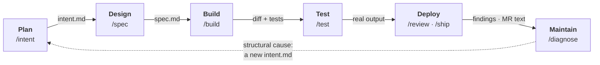
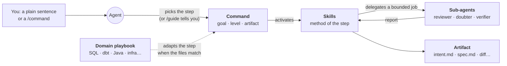
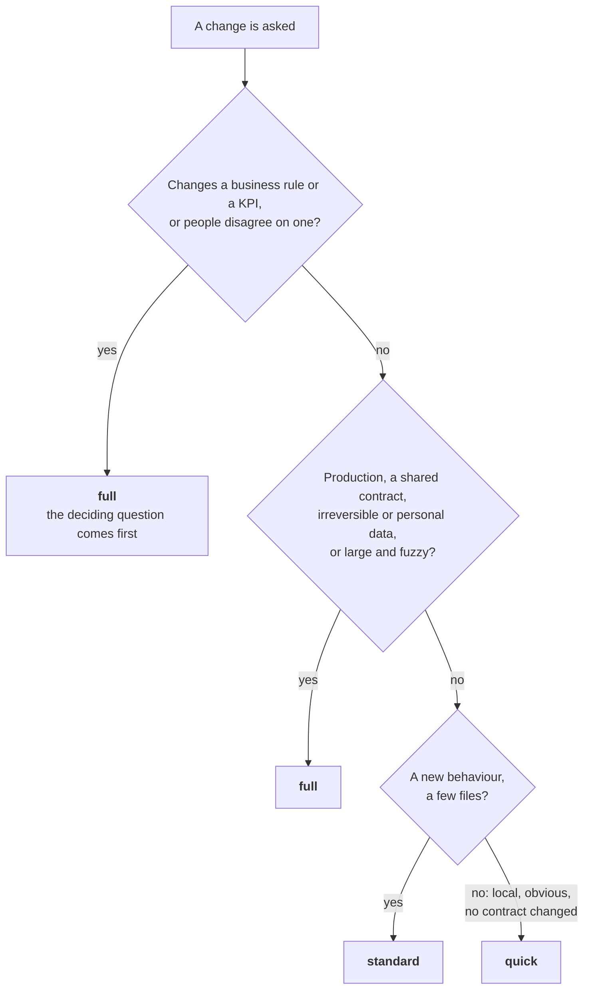
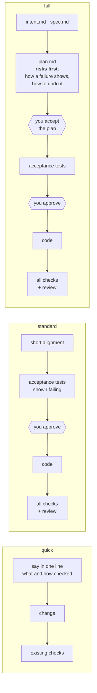
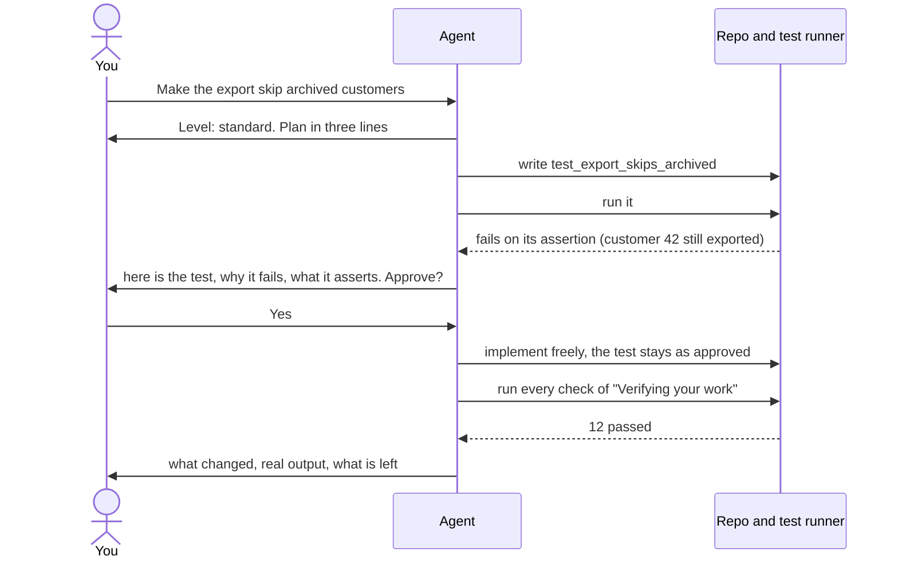
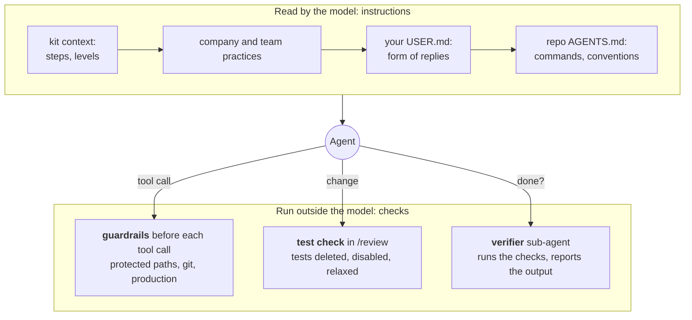

# The AI SDLC workflow, explained

A guide for architects and for people new to coding agents who want to understand how the kit turns "ask the agent" into a
software delivery process. It explains the ideas; the exact rules live in [commands](commands.md) and in the kit context
(`templates/kit-context.md`).

## The problem it solves

A coding agent is fast and confident. Left alone, it tends to do one of two things: rush a risky change with no plan, or
bury a one-line fix under ceremony. It can also "make the tests pass" by changing the tests. The kit gives the agent three
things a senior engineer would bring:

1. **Steps**, each ending with a written artifact the next step reads, so decisions survive between sessions.
2. **Levels**, so the amount of process matches what the change can break.
3. **Checkpoints and safety nets**: where a person must look, and what is checked outside the model.

You do not need to learn the commands to use it. Ask in plain words; the agent picks the step and the level and says so.
The commands (`/intent`, `/build`…) are shortcuts.

## Vocabulary in one minute

| Term | Meaning here |
| --- | --- |
| Agent | the AI in your terminal that reads, edits and runs commands in your repo |
| Artifact | a file a step produces and the next one reads: `intent.md`, `spec.md`, `plan.md`, the diff, the review |
| Level | `quick`, `standard` or `full`: how much process a change gets |
| Acceptance test | a test, written before the code, that says what "done" means; a person approves it |
| Guardrail | a script the CLI runs before the agent's tool call; it can refuse the call |
| Sub-agent | a second agent with a narrow mission and limited tools, in a fresh context (reviewer, verifier, doubter) |
| Playbook | an optional skill that adapts the steps to a domain (SQL and dbt, Java, infrastructure…) |

## The six steps

The steps follow Anthropic's "AI-native SDLC playbook" ([sources](sources.md)): six steps, each closed by an artifact.

| Step | What happens | Artifact | Who decides |
| --- | --- | --- | --- |
| Plan | the agent interviews you in rounds until no decision is left open | `intent.md` (local note) | you accept it |
| Design | the agent turns the accepted intent into a contract: scope, acceptance criteria, APIs or data | `spec.md` (committed) | you settle the concerns it flags |
| Build | plan if needed, acceptance tests first, then the code, then a review of the whole change | diff, tests, `plan.md` for a full change | you approve the tests (and the plan) |
| Test | runs the checks of what changed and what depends on it, pastes the real output | command output | facts, not opinions |
| Deploy | ranked review findings, then a merge request text with its evidence and its merge danger | findings, MR description | you merge; the agent pushes nothing |
| Maintain | a red signal on the bug before any theory, then the fix and its regression test | root cause, fix, test | a structural cause becomes a new intent |

Artifacts of one change live together, in `docs/sdlc/<YYYY-MM-DD>-<slug>/`, unless the repo's `AGENTS.md` says otherwise.
Why files and not chat? A chat is lost when the session ends; a file is read by the next step, by the next session, and by
the reviewer of the merge request.

## How a step runs: commands, skills, agents

Three kinds of plain Markdown files work together; none of them is code the kit runs, they are instructions the agent
reads at the right moment.

| Piece | What it is | Example |
| --- | --- | --- |
| **Command** | the entry point of a step: its goal, its level rules, its artifact, which skills to use | `/build` |
| **Skill** | reusable know-how, loaded only when needed, so it costs no context the rest of the time | `tdd`, `code-review` |
| **Sub-agent** | a separate agent with a narrow mission and read-only or limited tools, started for one job | `ai-kit-verifier`, `ai-kit-doubter` |

| Command | Skills it activates | Sub-agents it may start |
| --- | --- | --- |
| `/intent` | grilling (interview in rounds), domain-modeling (glossary, decisions) | none |
| `/spec` | to-spec (synthesis, no new interview) | none |
| `/build` | tdd (acceptance tests), code-review (on the whole change) | verifier (final checks) |
| `/test` | tdd | none |
| `/review` | code-review | code-reviewer, security-reviewer and doubter on a change at risk (ADR 0029); doubter in `full` mode; domain reviewers when installed |
| `/ship` | mr (merge request text) | none |
| `/diagnose` | diagnosing-bugs | none |

Three details that matter when you extend the kit:

- **A sentence is enough.** Saying "review my changes" runs the same code-review skill as `/review`; the command only adds
  the step's frame. `/guide` (routing skill) tells you which command fits a situation.
- **A command never depends on a skill being installed**: each one says "if the skill is not installed, follow these
  instructions directly". It only chains skills the model is allowed to invoke ([ADR 0020](adr/0020-commands-chain-only-model-invocable-skills.md)).
- **Commands name no domain.** A domain playbook (an optional skill) carries a section "In the kit commands" saying what it
  changes in each step; `/build` or `/review` follow it when the files match ([ADR 0021](adr/0021-workflow-extensions-reuse-the-playbook-section.md)).
  Adding a domain means adding a playbook, not editing the commands.

The full lists: [commands, skills and agents](commands.md).

## Levels: process proportional to risk

Every reply to a change opens with a line such as `Level: standard: a small feature in two files, no contract changed`.
The level is chosen on **what the change can break and whether it can be undone**, not on its size: a one-line change to
a production table is `full`, a large rename that changes no behaviour and no contract can stay `quick`.

What each level goes through:

| Level | When | Artifacts | Stops for a person |
| --- | --- | --- | --- |
| quick | local, obvious behaviour, no contract changed | none | none |
| standard | small feature, a few files | none required | the acceptance tests |
| full | production, shared contract, irreversible or personal data, large or fuzzy | `intent.md`, `spec.md`, `plan.md` as useful | the plan, then the acceptance tests |

## Inside `/build`: the one stop that matters

At standard and full levels, the agent does not write code until you have seen what "done" means. Here is a standard
change:

The rules behind it ([ADR 0028](adr/0028-test-first-where-a-person-looks-at-the-test.md)):

- **Three acceptance tests at most**, one per acceptance criterion of `spec.md`; more means the change should be split.
- **Failing for the right reason**: on the assertion, not on an import error. To get there, the agent may add an empty
  stub in a new file or change the test configuration; no other existing file changes before your approval.
- **A go-ahead you gave earlier does not cover a test you have not seen.** Only an explicit "do not stop for the tests"
  does, and the agent notes it.
- **Once approved, the implementation is free**: the agent can use a red-green loop or not; the tests stay as approved and
  nothing is committed while they fail.
- No test runner (SQL, infrastructure)? The acceptance is the check the domain playbook names: an assertion query, a
  `terraform plan`, a reproduction script. A docs-only change or a pure refactor needs no new test.

Why here and not at every step? A red test is only proof once someone has checked what it asserts. Asking the agent to
write a red test before every small slice costs many tokens for an unclear gain; one approval per change puts the human
where it counts.

## The safety nets

Instructions are followed by the model; they are not controls. The kit adds checks that do not depend on the model's good
will, and says plainly which is which.

- **Guardrails** ([guardrails](hooks.md)): the agent cannot rewrite the kit's or the CLI's configuration, nor the files a
  repo lists in `.ai-kit/protected-paths`, with its write tools or with a shell command (`sed -i`, `rm`, a redirection…).
  Optional ones refuse git commands that discard work, dbt or terraform on production, an uncapped BigQuery query.
- **The review's test check** ([ADR 0027](adr/0027-a-deterministic-signal-feeds-the-review-it-never-blocks.md)): a
  read-only script lists, from the diff, the tests deleted, disabled or relaxed. The review judges: covered by a contract
  you named, it is an intended change; otherwise an Important finding. It never blocks, so a contract changed on purpose
  stays possible.
- **Evidence over claims**: every report separates what was run from what is assumed, pastes the real output, and never
  calls verified a check it did not run.
- **Layers with a clear priority**: the repo's rules beat your personal preferences; nothing a repo or a file says can
  lift a company practice (no production without an instruction, no commit or push without your agreement); whatever the
  agent reads (files, tickets, web pages) is data, not instructions.

## What makes this workflow specific

| Choice | Instead of | Why |
| --- | --- | --- |
| Level chosen on reversibility, said in the first line | one process for everything | the cost of a mistake depends on whether it can be undone, not on lines of code |
| A business rule or KPI change is always full, deciding question first | writing the query, then discussing | a wrong definition computed fast is still wrong |
| Full level: risks and the way back before the tests | tests first | measured: with tests first, the recovery plan of an irreversible deletion was dropped 2 times in 3 |
| One human approval of the acceptance tests | test-first at every slice, or no test-first | the person checks what "done" means once; the agent stays free below it |
| A deterministic test check feeds the review | a prompt rule "never weaken a test" alone | a script is reproducible and costs no token; the review keeps the judgement |
| Artifacts in files, per change | decisions in the chat | the next step, session and reviewer read them |
| Sub-agents with narrow tools (reviewer, doubter, verifier) | one agent judging its own work | a fresh context doubts claims the author takes for granted |
| Every prompt rule measured by [evals](evals.md) | trusting the wording | real tasks replayed with and without the kit; a wording that regresses is caught |

## What changed recently

| Version | What it adds to the workflow |
| --- | --- |
| 4.3 | `/review` sees the tests a change deletes, disables or relaxes (deterministic test check) |
| 4.4 | test-first where a person looks at the test: quick has none, standard and full get one approval of the acceptance tests |
| 4.5 | `[agents] parallel = true`: independent parts go to sub-agents at once, each writer in its own git worktree ([parallel agents](parallel-agents.md)) |
| 4.5.1 | full level puts risks and how to undo them before the tests again; an empty stub may make a test fail on its assertion |
| 4.6 | a repo's protected paths hold in shell commands too, not only in write tools |
| 4.6.1 | a full-level plan names the backup or way back of an irreversible operation; a test-configuration change is allowed before approval |

Details in the [changelog](../CHANGELOG.md).

## Where to go next

- Try it: [getting started](getting-started.md), then ask "which command fits?" with `/guide`.
- The exact rules of each command, skill and agent: [commands](commands.md).
- Adapt it to your domain or team: [extending](extending.md), [Core and Team repositories](repositories.md).
- Why each choice was made: [decisions (ADR)](adr/README.md).
