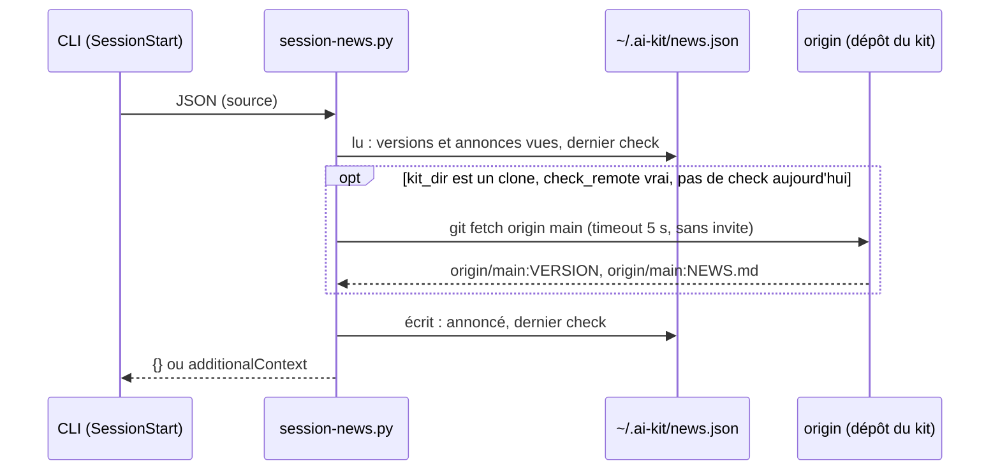

# Spec: nouveautés du kit annoncées au lancement d'une session, mise à jour proposée (from intent.md 2026-11-01)

Status: draft · Reviewed by: Hachem LATRACH · Date: 2026-11-02 · Versioned: this file is the contract reviewers read in the merge request (MR)

Level: full (hérité de l'intent : quatre adaptateurs, un accès réseau au démarrage, une mise à jour déclenchée depuis la session). ADR associé : `docs/adr/0012-a-session-hook-may-read-the-kit-remote-never-write-never-send.md`.

## Objective
Au lancement d'une session dans chacun des quatre CLI, l'agent dit une fois, en une ligne par nouveauté, ce qui est nouveau : la version installée, les annonces du dépôt du kit, une version disponible ; la mise à jour reste un geste de la personne.

## Scope and non-goals
- In : un hook `session-news` (script, manifeste, quatre adaptateurs, tests par CLI) ; un fichier `NEWS.md` à la racine du dépôt et sa vérification en CI ; une sous-commande `ai-kit news` ; les réglages `[hooks] session-news` et `[news]` (schémas, `organization.toml`) ; `doctor` ; les docs et le CHANGELOG.
- Out : la mise à jour lancée par le hook ou par l'agent ; un `systemMessage` ; un check par URL (installations ZIP) ; une mise à jour forcée par l'organisation ; la langue des annonces ; toute télémétrie.

## Requirements
Chaque exigence a un critère d'acceptation vérifiable.

1. **Un hook, quatre CLI.** `runtime/hooks/session-news.py` est déclaré sur l'événement `SessionStart` de chaque CLI par son adaptateur, à côté des gardes-fous, sans `matcher` : le script lit lui-même `source` dans l'entrée et ne répond qu'à `startup` et `resume` (une entrée sans `source` vaut `startup`). — Acceptance : après `update`, `doctor` montre le hook sur chaque CLI choisi ; les tests alimentent le script avec l'entrée JSON de chaque CLI et vérifient la sortie ; un `/clear` ou une compaction ne produit rien.
2. **Jamais de blocage.** Le script répond toujours un JSON `{}` ou `{"hookSpecificOutput": {"hookEventName": "SessionStart", "additionalContext": "…"}}`, exit 0, même sur entrée invalide ou dépôt absent ; sans check distant il termine en moins d'une seconde. — Acceptance : test sur entrée vide, non JSON, sans `state.json` ; test de durée hors réseau.
3. **Version installée annoncée une fois.** Quand `state.json` porte une version absente du marqueur, le contexte contient la section `## <version>` du CHANGELOG installé (celui du dossier du kit), puis le marqueur l'enregistre. — Acceptance : première session après `update` : contexte avec la section ; deuxième session : rien.
4. **Annonces de `NEWS.md`.** Les annonces non encore enregistrées dans le marqueur, visées par le profil et l'équipe de `state.json` (sans champ : tout le monde), non expirées (`until` absent ou ≥ aujourd'hui), sont ajoutées au contexte, puis enregistrées. Sources : le `NEWS.md` du dossier du kit, et celui d'`origin/main` quand le check du jour a tourné. — Acceptance : tests avec des annonces globale, ciblée pour un autre profil, expirée, déjà vue ; seule la première passe.
5. **Version disponible.** Au plus une fois par jour (date du dernier check dans le marqueur), si `[news] check_remote` n'est pas `false` et si le dossier du kit est un clone git avec un `origin` : `git fetch --quiet origin main` avec `GIT_TERMINAL_PROMPT=0`, timeout 5 s, puis lecture de `origin/main:VERSION` et `origin/main:NEWS.md` par `git show`, sans toucher au dossier de travail. Si la version distante est plus grande que celle installée et n'est pas la version refusée, le contexte dit « version X disponible » et demande à l'agent de proposer la mise à jour. Tout échec (pas de git, pas de réseau, identifiants manquants, timeout) est silencieux, noté dans le marqueur pour `doctor`. — Acceptance : tests avec un dépôt local comme `origin` (version plus grande, égale, refusée, fetch qui échoue, deuxième lancement le même jour) ; aucun test n'atteint le réseau (`scripts/offline_tests.py` reste vert).
6. **Ce que l'agent dit.** Le contexte injecté commence par une consigne : une ligne par nouveauté dans la première réponse, le détail sur demande ; pour une version disponible, proposer, et sur le oui donner `ai-kit update` à lancer dans un terminal en disant ce qui va changer ; sur le non, lancer `ai-kit news --later` et ne plus en parler. — Acceptance : le texte de la consigne est dans un test ; la revue vérifie qu'il ne demande jamais à l'agent de lancer `update`.
7. **`ai-kit news`.** Le script `~/.ai-kit/bin/news.py`, même mécanisme que `friction.py` (bibliothèque standard, `--home`) : `--later` enregistre la version refusée ; `--list` montre le marqueur (dernier check, annonces vues, version refusée) ; `--check` force un check distant maintenant et affiche le résultat. `ai-kit news` l'appelle depuis le launcher. — Acceptance : tests des trois options ; `--later` sans version disponible dit qu'il n'y a rien à refuser.
8. **Réglages.** `[hooks] session-news = false` coupe le hook (comme les gardes-fous, défaut `true`) ; `[news] check_remote = false` coupe le réseau seulement ; les deux acceptés dans `defaults` de `organization.toml`, la personne garde le dernier mot ; schémas mis à jour ; `update` résout le tout dans `state.json` (`news.check_remote`) et y enregistre le dossier du kit (`kit_dir`), que le hook lit. — Acceptance : CI des schémas verte ; tests de résolution ; le hook sans `kit_dir` ne fait aucun check.
9. **`NEWS.md` vérifié en CI.** Un script `scripts/check_news.py` échoue sur une section mal formée, un identifiant en double, une date invalide, un profil ou une équipe inconnus. — Acceptance : exécuté dans `portability.yml` à côté des schémas ; test avec un fichier faux.
10. **`doctor`.** Une ligne par CLI pour le hook (présent, configuré, test synthétique) comme pour les gardes-fous ; `[Info]` sur la date du dernier check, son résultat, et les annonces en attente ; `[Check]` quand `kit_dir` n'existe plus. — Acceptance : tests de doctor.
11. **Docs.** `hooks.md` (section `session-news`), `cli/matrice.md` (ligne du hook, événement par CLI), les quatre pages CLI (Codex : « Trust » redemandé, Gemini : avertissement sur hook modifié), `customization.md` (`[news]`, écrire une annonce), CHANGELOG. — Acceptance : relecture ; `cli_drift.py` inchangé.

## Contracts
| Object | Shape | Key | Sources | Freshness | Rules |
| --- | --- | --- | --- | --- | --- |
| `NEWS.md` (racine du dépôt) | une annonce par section `## <YYYY-MM-DD> <id> : <titre>` ; lignes suivantes optionnelles, une clé par ligne : `profiles: a, b`, `teams: x`, `until: YYYY-MM-DD` ; puis le texte Markdown | `id` : `[a-z0-9-]{3,32}`, unique dans le fichier | écrit par le mainteneur, par merge request | lu au démarrage (local) et une fois par jour (`origin/main`) | sans champ : globale ; `until` passé : ignorée ; section illisible : ignorée, comptée par `doctor` ; le dépôt public ne porte que des annonces génériques (ADR 0009) |
| Entrée du hook (stdin) | JSON du CLI : `source` (`startup`, `resume`, `clear`, `compact`, `fork`) quand il existe ; le reste ignoré | — | Claude Code, Codex, Gemini CLI, agy | — | `source` absent = `startup` |
| Sortie du hook (stdout) | `{}` ou `{"hookSpecificOutput": {"hookEventName": "SessionStart", "additionalContext": "<texte ≤ 8 000 caractères>"}}` | — | — | — | exit 0 toujours ; jamais de texte hors JSON (Gemini le rendrait à la personne) |
| Marqueur `~/.ai-kit/news.json` | `{"announced_versions": [...], "announced_news": [...], "declined_version": "x.y.z", "last_check": {"date", "result", "remote_version"}}` | — | écrit par le hook et par `news.py` seulement | — | lisible par la personne seulement ; aucune donnée personnelle, aucun texte d'annonce |
| `state.json` | nouveaux champs `kit_dir` (chemin du dossier du kit) et `news.check_remote` (bool) | — | `update` | à chaque `update` | `kit_dir` absent : pas de check distant |
| Réglages | `[hooks] session-news = true|false` ; `[news] check_remote = true|false` | — | `organization.toml` `defaults`, `overrides.toml` | `update` | la personne a le dernier mot (ADR 0008) |
| `ai-kit news` | `--later`, `--list`, `--check`, `--home` | — | launcher → `news.py` | — | `--later` et `--check` écrivent le marqueur ; rien d'autre |

Flux du check distant :

## Constraints and policies applied
- ADR 0004 (pas de réseau dans l'installateur) : inchangé ; le réseau du hook est borné par l'ADR 0012 : lecture seule, une fois par jour, timeout, silence sur échec ; `offline_tests.py` reste vert.
- ADR 0006 (l'agent ne change pas sa configuration) : le hook n'est jamais lancé par l'agent ; `ai-kit news --later` est une écriture du kit sous `~/.ai-kit/`, autorisée comme `friction.py` ; `protected-paths` inchangé.
- ADR 0007 (une ligne locale, rien n'est envoyé) : le marqueur suit le modèle ; aucune donnée ne quitte le poste.
- ADR 0008 (organisation, profil, équipe, personne) : les deux réglages suivent la fusion existante.
- ADR 0009 (dépôt public générique) : les annonces d'une organisation vivent dans sa copie du dépôt.
- Pratiques d'équipe : contrat du hook énoncé (jamais de blocage, toujours un JSON) ; coût mesuré (durée du hook hors réseau) ; checks réels joints au `/build`.
- Pratiques d'entreprise : aucun secret (identifiants git de la personne, jamais lus par le kit) ; aucune donnée personnelle dans le marqueur.
- Règle 6 du contexte du kit : la consigne injectée dit à l'agent de donner la commande, jamais de la lancer.

## Areas of concern
- **Codex et Gemini redemandent confiance** pour un hook nouveau (première installation) ou dont la commande change (chemin du Python ou du script). Une fois par changement, documenté ; le mainteneur accepte ce coût. Décide : mainteneur.
- **agy** : l'événement `SessionStart` existe, mais rien ne prouve que `additionalContext` atteint le modèle. À prouver en session réelle avant de l'annoncer pour agy ; sinon agy reste sur le message terminal d'`update`, les trois autres livrent. Décide : mainteneur, sur le résultat du test.
- **Réseau d'entreprise** : un `git fetch` qui attend un proxy peut prendre les 5 s du timeout, une fois par jour, au démarrage. Acceptable ? Sinon `check_remote = false` dans `defaults`. Décide : organisation.
- **Claude Code attend la fin des hooks** avant la première réponse : la même seconde au pire, un jour sur un. Décide : mainteneur.
- **Clone avec changements locaux** : le fetch ne les touche pas, mais `update` refusera ensuite (`git pull --ff-only`) ; l'agent le dira en donnant la commande. Pas de contradiction, à documenter.

## Open questions
- Preuve agy (voir ci-dessus) : un appel modèle, à faire au `/build`.
- Later : check par URL pour les ZIP ; mise à jour forcée par l'organisation (réglages gérés par l'IT) ; langue des annonces.
- Le découpage en tranches se fait au `/build`.
