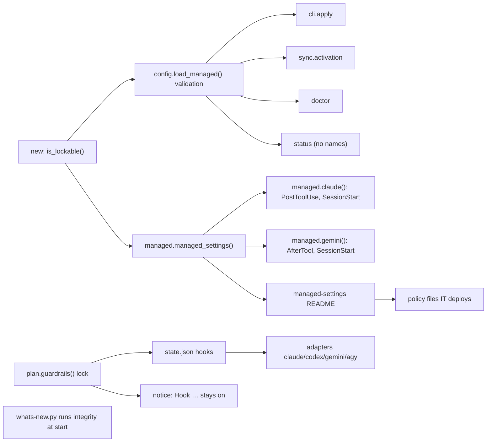

# Spec: le contrôle d'intégrité verrouillable par l'IT — 4.17.0 (from intent.md 2026-11-15)

Status: accepted (2026-11-15) · Reviewed by: Hachem LATRACH · Date: 2026-11-15 · Versioned: this file is the contract reviewers read in the merge request (MR)

Level: full (hérité de intent.md) : contrat de configuration IT (`managed.toml`, fichiers `ai-kit managed-settings`), amendement de l'ADR 0030.

## Objective
Permettre à l'IT d'empêcher qu'une personne ou un agent coupe le contrôle d'intégrité sur un poste géré, en le verrouillant dans `managed.toml` et, là où la CLI le permet, dans les fichiers de politique qu'elle déploie.

## Scope and non-goals
- In (4.17.0) :
  - `managed.toml` : `[hooks] locked` accepte `integrity` ; verrouiller `integrity` verrouille aussi `whats-new` ;
  - l'installation : un hook verrouillé reste actif quoi que dise `aikit.toml`, et le lancement le dit ;
  - `ai-kit managed-settings` : `integrity` et `whats-new`, quand ils sont verrouillés, dans les fichiers de politique de **Claude Code** (`PostToolUse`, `SessionStart`) et de **Gemini CLI** (`AfterTool`, `SessionStart`, hors Windows comme aujourd'hui) ;
  - ADR 0030 amendé ; `docs/hooks.md`, `docs/compliance.md`, `docs/configuration.md`, pages CLI, `templates/managed-settings-README.txt`.
- Out :
  - **agy dans un fichier de politique** : agy n'en a pas ; le verrou passe par `managed.toml` seul, limite écrite (décision du 2026-11-15) ;
  - les garde-fous (`PreToolUse`) dans le fichier de politique de Codex (chantier suivant) ;
  - verrouiller par défaut (décision : au choix de l'IT) ;
  - rendre `integrity` bloquant (il signale, ADR 0030) ;
  - les limites connues du contrôle (marqueur réécrit, coupe-circuit général des hooks hors de la partie du kit).

## Requirements
Each requirement has a verifiable acceptance criterion.

**R0 — Une notion à part : « verrouillable ».** `is_guardrail` ne change pas (garde-fou = avant un appel d'outil) : le compte, la ligne « Guardrails … on/off » et les libellés restent ceux d'aujourd'hui. Une fonction `is_lockable` (les garde-fous et `integrity`) sert à la validation de `managed.toml` et à `managed_settings`. `managed.locked()` (verrouillés par défaut) reste limité aux garde-fous par défaut : `integrity` n'y entre que si l'IT le nomme.
— Acceptance : sans `managed.toml`, les fichiers générés et le résumé d'installation sont identiques à la 4.16.0 (test sur les fichiers et sur la ligne « Guardrails »).

**R1 — Ce que l'IT peut verrouiller.** `load_managed` accepte dans `[hooks] locked` les cinq garde-fous et `integrity` ; `[hooks] integrity = true|false` est accepté comme pour un garde-fou (`false` : coupé pour tous, non verrouillé). `whats-new` n'est pas nommable seul : il suit `integrity`. Le message de refus liste les noms acceptés.
— Acceptance : test — `locked = ["integrity"]` accepté ; `locked = ["integrity"]` avec `integrity = false` refusé (contradiction, règle actuelle) ; `locked = ["whats-new"]` refusé avec un message qui dit qu'il suit `integrity` ; un nom inconnu refusé.

**R2 — L'installation respecte le verrou.** Avec `integrity` verrouillé, `aikit.toml` qui met `integrity = false` (ou `whats-new = false`) est ignoré pour les deux hooks, et le lancement affiche `[Info] Hook integrity stays on` (et `whats-new`), libellé « Hook » et non « Guardrail » pour ces deux-là ; une personne qui met `whats-new = false` alors qu'`integrity` est verrouillé le voit aussi rester. Sans verrou, rien ne change.
— Acceptance : test d'installation (préréglage) — les deux hooks restent installés malgré `false` ; le message apparaît ; sans `managed.toml`, `integrity = false` les retire comme aujourd'hui.

**R3 — Claude Code : fichier de politique.** `ai-kit managed-settings`, quand `integrity` est verrouillé, ajoute à `claude-code/managed-settings.json` un groupe `hooks.PostToolUse` **sans matcher** (tous les outils ; `hook_matcher` n'est pas utilisé pour lui, il rendrait les seuls outils d'écriture) qui lance `integrity.py`, et un groupe `hooks.SessionStart` qui lance `whats-new.py`, avec le même interpréteur et le même chemin que les garde-fous déjà générés ; sous Windows (`windows/claude-code/…`), par PowerShell comme les garde-fous.
— Acceptance : test sur les fichiers générés (POSIX et Windows) — groupes présents seulement quand verrouillé, `PostToolUse` sans matcher ; même forme de commande que les garde-fous ; avec `--managed-hooks-only`, `allowManagedHooksOnly` est écrit et les deux hooks y sont. Hook en double (fichier de politique et `~/.claude/settings.json` de la personne, sans `--managed-hooks-only`) : un changement est signalé une fois (marqueur de l'intégrité), test à deux lancements.

**R4 — Gemini CLI : fichier de politique.** Même chose dans `gemini-cli/settings.json` : `hooks.AfterTool` et `hooks.SessionStart`, sans clé `matcher` quand elle est vide (comme l'adaptateur) ; rien sous Windows (règle actuelle : la doc de Gemini CLI ne dit pas quel shell lance un hook).
— Acceptance : test sur les fichiers générés.

**R5 — Codex : fichier de politique ; agy : la limite dite.** (Décision du 2026-11-15 au build, après lecture du code source de Codex : `ConfigRequirementsToml.hooks: ManagedHooksRequirementsToml`, `[features]` en table nom → booléen ; pris en charge depuis avril 2026, openai/codex #18893.) Quand `integrity` est verrouillé, `codex/requirements.toml` reçoit :
```toml
[features]
hooks = true                      # the person cannot turn hooks off ([features] hooks = false)

[[hooks.PostToolUse]]             # matcher = "*": every tool (Codex maps "" and "*" to All)
[[hooks.PostToolUse.hooks]]
type = "command"
command = "<POSIX command, as for the guardrails>"
command_windows = "<cmd.exe command: %USERPROFILE%, no PowerShell syntax>"

[[hooks.SessionStart]]
[[hooks.SessionStart.hooks]]
type = "command"
command = "…whats-new.py"
command_windows = "…whats-new.py (cmd.exe syntax)"
```
Codex lance un hook sous Windows par `cmd.exe /C` (code source : `hooks/src/engine/command_runner.rs`, `COMSPEC` sinon `cmd.exe`) : `command_windows` est en syntaxe `cmd` (`%USERPROFILE%`), jamais PowerShell ; vérifié au build sur la VM Windows (la forme `cmd` s'exécute, la forme PowerShell échoue : « & était inattendu »). Les hooks gérés de Codex s'ajoutent à ceux de la personne (« Matching hooks from multiple files all run »). Les garde-fous (`PreToolUse`) ne sont pas ajoutés à ce fichier dans cette version (chantier suivant). Pour **agy**, aucun fichier de politique : `integrity` verrouillé tient par l'installation du kit (`managed.toml`, réinstallé à chaque `sync`) ; `templates/managed-settings-README.txt` et `docs/hooks.md` le disent.
— Acceptance : test sur `codex/requirements.toml` généré — le TOML se relit (`tomllib`), contient `[features] hooks = true`, `hooks.PostToolUse` sans matcher et `hooks.SessionStart`, avec `command` et `command_windows` ; rien de tout cela sans verrou ; test de contenu sur le README (limite agy). Non essayé sur un Codex géré (il faut `/etc/codex`, donc des droits admin) : dit dans le CHANGELOG.

**R6 — Le README généré.** Il liste les hooks verrouillés (garde-fous, et `integrity` et `whats-new` quand c'est le cas) et rappelle qu'`integrity` signale, ne bloque pas.
— Acceptance : test sur le README généré.

**R7 — Doc et ADR.** ADR 0030 : ligne « Amended: 4.17.0 » ; `docs/hooks.md` : la phrase « IT can name the five guardrails… `integrity` and `whats-new` are not guardrails in managed.toml… » devient vraie pour la nouvelle version (verrouillable, `whats-new` suit) ; `docs/compliance.md` (limites) et `docs/configuration.md` (`managed.toml`) ; pages CLI (Claude Code, Gemini CLI, Codex, agy) : ce qui part dans le fichier de politique.
— Acceptance : tests de contenu ; `test_doc_links` vert.

**R7b — Tests de contrat qui changent volontairement.** `tests/test_managed.py:88` (`whats-new` non verrouillable) change de règle : `whats-new` reste non nommable seul mais suit `integrity` ; le test est mis à jour, nommé dans le CHANGELOG, et un test prouve la nouvelle règle. `schemas/managed.schema.json` (`hooks.locked` : « Guardrails kept on ») est aligné. `ai-kit status` (`status.py:25`, `load_managed` sans noms) ne signale pas à tort `locked = ["integrity"]` : à vérifier, corrigé si besoin.
— Acceptance : tests nommés dans le CHANGELOG ; test `status` avec `locked = ["integrity"]`.

**R8 — Livraison.** VERSION 4.17.0, CHANGELOG, versions, snapshot ; suite complète sur Mac, Linux, Windows ; essai des fichiers générés pour Windows sur la VM (lancer à la main la commande PowerShell du hook `integrity` écrite dans `windows/claude-code/managed-settings.json`).
— Acceptance : CI verte sur les trois OS ; sortie de l'essai VM collée dans le rapport.

## Contracts
| Object | Shape (fields, or one row per … for data) | Key | Sources | Freshness | Rules (compatibility, dates, exclusions, NULL) |
| --- | --- | --- | --- | --- | --- |
| `managed.toml` `[hooks]` | `locked = [noms]`, `<nom> = true|false` | nom de hook | IT | au déploiement | noms acceptés : les cinq garde-fous et `integrity` ; `whats-new` suit `integrity` ; pas de rétrocompatibilité à garder |
| `claude-code/managed-settings.json` | `hooks.PreToolUse` (inchangé) + `hooks.PostToolUse` et `hooks.SessionStart` quand `integrity` est verrouillé | — | `ai-kit managed-settings` | à la génération | même interpréteur et chemins que les garde-fous |
| `gemini-cli/settings.json` | `hooks.BeforeTool` (inchangé) + `AfterTool` et `SessionStart` quand verrouillé ; rien sous Windows | — | idem | idem | — |
| `codex/requirements.toml` | inchangé sans verrou ; avec `integrity` verrouillé : `[features] hooks = true`, `[[hooks.PostToolUse]]`, `[[hooks.SessionStart]]` | — | idem | idem | `command` et `command_windows` comme les garde-fous |

## Constraints and policies applied
- **Le kit ne change jamais la configuration IT ni celle d'une CLI** (00_KIT) : il génère les fichiers, l'IT les déploie.
- **ADR 0030** : le contrôle signale, il ne bloque pas ; le verrou le garde actif, rien de plus.
- **ADR 0015** (managed.toml) : un hook que l'IT coupe n'est pas verrouillé ; même règle pour `integrity`.
- **Aucun comportement nouveau par défaut** (intent) : sans `locked = ["integrity"]`, fichiers générés et installation identiques à la 4.16.0.
- Mac, Linux, Windows ; aucune installation ; evals seulement sur demande.

## Threats
- Une personne ou un agent coupe la surveillance de la configuration (`integrity = false`, ou retire le hook du fichier d'une CLI) — verrou dans `managed.toml` (réinstallé à chaque sync) et, pour Claude Code et Gemini CLI, hook dans le fichier de politique que la personne ne peut pas modifier — résiduel : Codex et agy n'ont que le verrou du kit (R5) ; un coupe-circuit général des hooks d'une CLI hors de la partie du kit reste hors de portée (limite connue, `doctor` le vérifie).
- Un hook de politique qui ne démarre pas (interpréteur ou chemin faux sur un poste) — même commande que les garde-fous déjà générés et déployés ; essai Windows sur la VM — résiduel : un poste dont l'installation diffère du chemin attendu ; la CLI affiche l'erreur à chaque appel, l'IT le voit.

## Areas of concern
- **Bruit sur les postes verrouillés** : chaque changement est signalé sans pouvoir couper ; voulu, la personne passe par `ai-kit sync --offline --restore` ou demande à l'IT.
- **Faux sentiment de sécurité** : verrouillé, le contrôle reste un signal ; la doc le redit (R6, R7).
- **agy** : le verrou y est plus faible (R5) ; accepté le 2026-11-15. **Codex** : fichier de politique écrit d'après le code source, non essayé sur un Codex géré.
- **Carte de portée** (blast-radius, contexte neuf, recherche texte, 2026-11-15) :

| Atteint | Pourquoi | Preuve | À tester avant le merge |
| --- | --- | --- | --- |
| `managed.locked()` | `integrity` et `whats-new` sont `default: true` | `installer/managed.py:23-25`, `runtime/hooks/hooks.json:38-50` | sans verrou : fichiers inchangés (R0) |
| `managed.claude()` | matcher par `hook_matcher`, `PreToolUse` seul | `installer/managed.py:80-91`, `adapters/claude.py:166-170` | `PostToolUse` sans matcher (R3) |
| hook en double | l'adaptateur personnel écrit déjà `integrity` | `adapters/claude.py:224-232` | signalé une fois (R3) |
| `load_managed`, `apply_values`, `provenance` | validation et messages par nom | `installer/config.py:76-86, 136-160` | cas `integrity` (R1, R2) |
| `status` | `load_managed()` sans noms | `installer/status.py:25` | R7b |
| test de contrat | `whats-new` non verrouillable | `tests/test_managed.py:88` | mis à jour volontairement (R7b) |
| docs, ADR 0030 et 0015, schéma, README généré | décrivent la limite actuelle | `docs/hooks.md:37-40,139-152`, `docs/compliance.md:34,50-52`, `schemas/managed.schema.json:15-30` | R5-R7 |
Limites de la carte : recherche texte ; noms construits à l'exécution non vus ; fichiers déjà déployés par l'IT (contrat externe, à régénérer) et support réel des hooks gérés par chaque CLI hors du repo.

## Open questions
- Assumption: Claude Code accepte `PostToolUse` et `SessionStart` dans `managed-settings.json` comme `PreToolUse` (les hooks gérés sont des hooks ordinaires). — à vérifier dans la doc de Claude Code au build.
- Assumption: Gemini CLI applique `AfterTool` et `SessionStart` déclarés dans ses paramètres système. — à vérifier dans sa doc au build.
- Vérifié au build (code source de Codex, avril 2026, #18893) : `requirements.toml` accepte `[hooks]` et `[features]` ; décision : Codex reçoit le hook (R5).
- Vérifié au build (doc de Claude Code) : `managed-settings.json` a le même format que `settings.json`, les hooks de tous les niveaux s'additionnent, un matcher omis couvre tous les outils.
- Non vérifié (page 404) : l'emplacement des paramètres système de Gemini CLI ; R4 suit le format déjà écrit pour `BeforeTool`.
- Terme proposé pour le glossaire de la doc : « hook verrouillable » (les cinq garde-fous et le contrôle d'intégrité).
- Découpage en tâches : `/build` ou le skill `to-tickets`.
